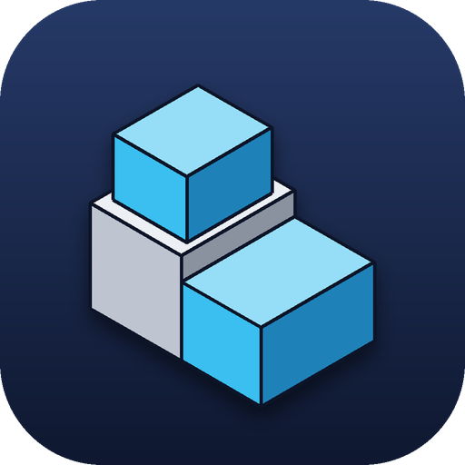
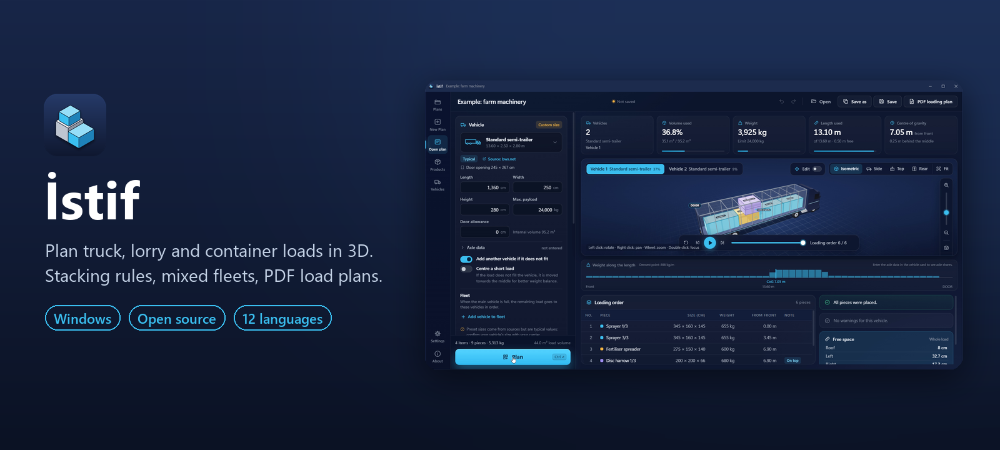
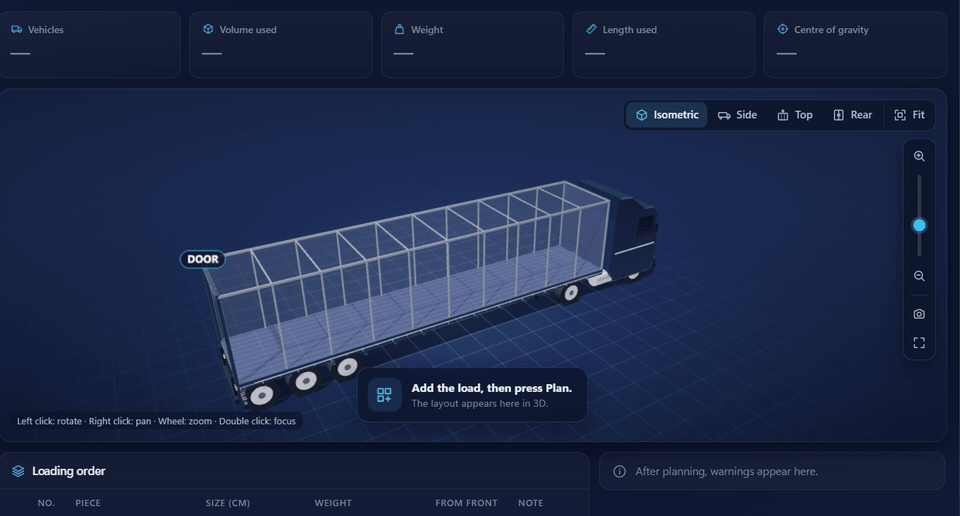
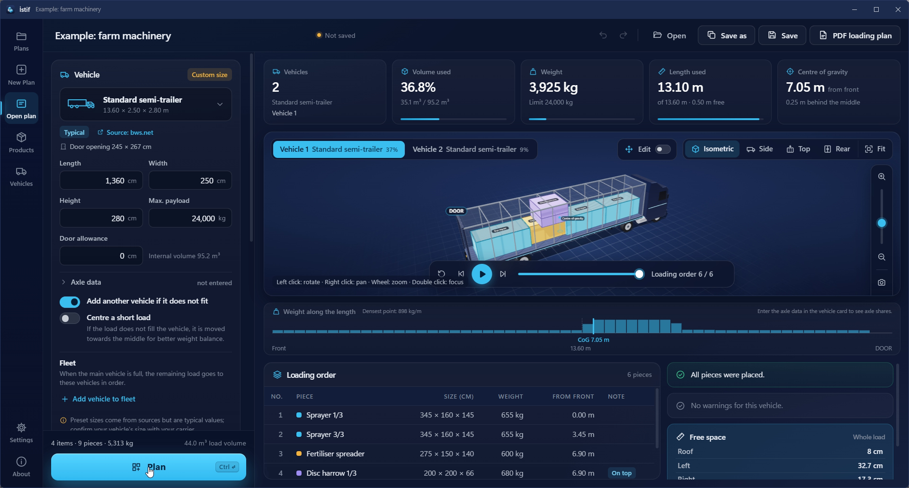
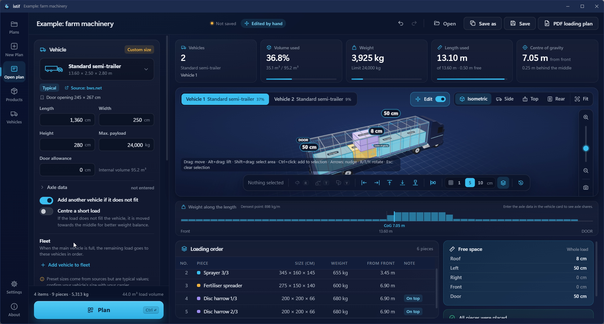
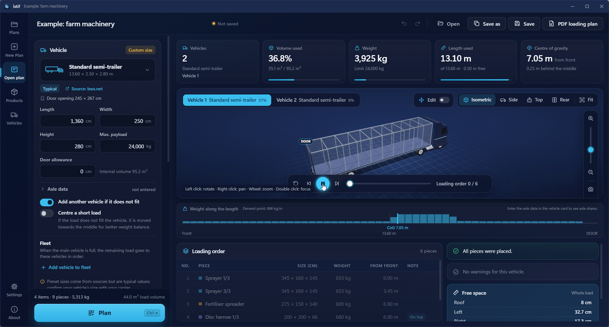
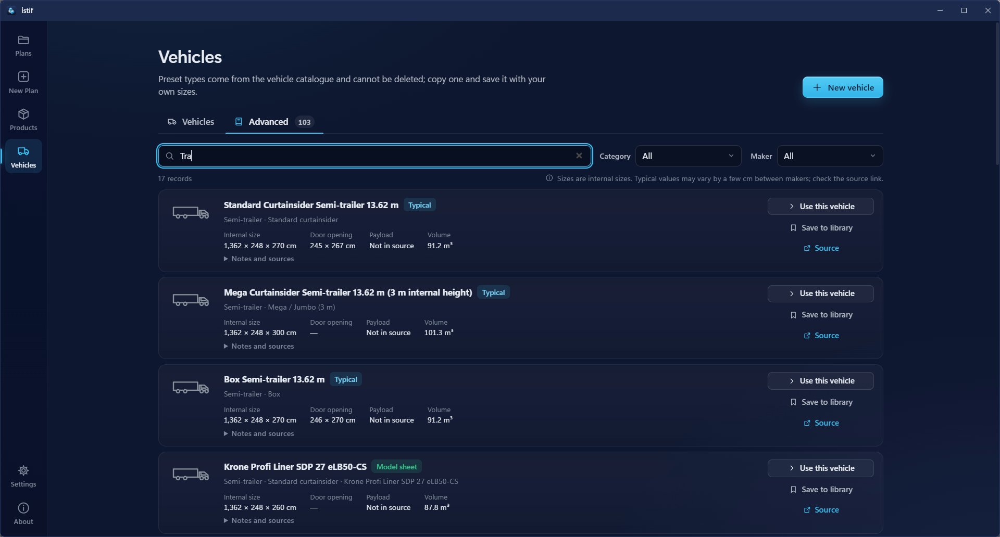
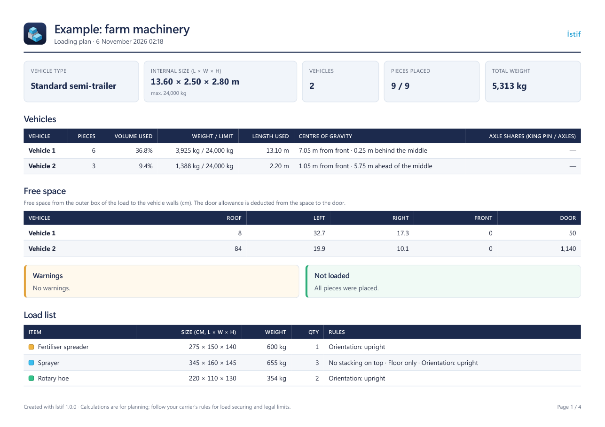

<p align="center">
  
</p>

<h1 align="center">İstif</h1>

<p align="center">Plan truck, lorry and container loads in 3D. Enter the vehicle, add your cargo, watch it load step by step, then fine-tune it by hand.</p>

<p align="center"><a href="README.tr.md">Türkçe</a></p>

<p align="center">
  <a href="https://github.com/ceceys/istif/releases/latest/download/Istif-Setup.exe"></a>
</p>

<p align="center">Installer · <a href="https://github.com/ceceys/istif/releases/latest/download/Istif.exe">Portable exe</a> · <a href="https://github.com/ceceys/istif/releases/latest">All files</a></p>



**İstif** (Turkish for *stowage*) is a free, open source load planner for Windows. You enter the vehicle size and your machines, crates and boxes. İstif places them in 3D, tells you how many vehicles you need and shows the loading order one piece at a time. If you want a different layout, you can move and rotate pieces by hand and see how much space is left.



## Why it exists

At work, a truck load was being planned. The load was agricultural machinery, and the sprayers could not be stacked on top of each other. It did not fit a standard truck, and I could not find a good tool where the truck size could be set freely. İstif was built for that need.

— Cuma Ali Dirik

## Features

- **Any vehicle**: type in the size of your truck, lorry or container, or pick one from the built-in catalogue of containers, semi-trailers, panel vans and wagons. Every catalogue entry shows its source.
- **Rules per item**: can't stack on top, floor only, top load limit (kg), rotation lock (free / upright / fixed) and delivery order.
- **Clear planning order**: first the fewest vehicles, then the shortest length used, then balanced weight. The same input always gives the same plan.
- **Mixed fleet**: when the truck is full, the rest of the load can go to a smaller vehicle. Door allowance and "centre a short load" for axle balance.
- **3D view**: pieces drop into place in loading order, step by step. Zoom, focus, side / top / rear views, full screen, PNG export.
- **Edit by hand**: select one or more pieces, drag them, rotate them (R / T / Y), push them against a wall. İstif checks every move at once: collisions, overhang, unsupported pieces and stacking rules turn red.
- **Space left**: see how many centimetres remain to the roof, the left and right walls, the front wall and the door, for a selection or for the whole load.
- **Centre of gravity and axle share**: shown as an estimate, with the weight along the length of the vehicle.
- **PDF loading plan**: ready for the warehouse and the driver, with the loading order and the space left.
- **Import from Excel or CSV** with column matching and units.
- **12 languages**: Türkçe, English, Deutsch, Français, Español, Italiano, Português, Русский, العربية, 中文, 日本語, 한국어.
- **Dark, light or system theme**, metric or imperial units, undo / redo, automatic draft.
- **Private**: the app goes online only to check for updates. Your plan and load data are never sent anywhere.





## Install

1. **[Download Istif-Setup.exe](https://github.com/ceceys/istif/releases/latest/download/Istif-Setup.exe)** and run it.
2. Open İstif from the Start menu.

Portable alternative: [Istif.exe](https://github.com/ceceys/istif/releases/latest/download/Istif.exe), a single file without installation. All versions are on the [Releases](https://github.com/ceceys/istif/releases) page.

Windows may show a SmartScreen warning because the program is not code-signed: choose "More info", then "Run anyway".

## First use

1. On the start screen, open one of the **examples** to see a finished plan.
2. Or start a **new plan**: choose the vehicle, add your cargo, press **Plan**.
3. Press **Play** in the 3D view to watch the loading order.
4. Turn on **Edit** to move or rotate pieces by hand.
5. Save the **PDF loading plan** for the warehouse and the driver.

The full guide with screenshots: [docs/rehber/en.md](docs/rehber/en.md) (Türkçe: [docs/rehber/tr.md](docs/rehber/tr.md)).







## Privacy

- İstif goes online only to check GitHub for a new version, at most once a day. You are asked before anything is downloaded, and the file is verified with `SHA256SUMS.txt` before it is installed. The check can be turned off in Settings.
- Your plans, vehicles and load lists stay on your computer.
- Plan files are `.istif` files saved where you choose.

## System requirements

- Windows 10 or 11 (64-bit)
- [.NET 8 Desktop Runtime](https://dotnet.microsoft.com/download/dotnet/8.0) (x64)
- Microsoft Edge WebView2 Runtime (included in Windows 11)

## Note

Calculations are for planning. For load securing and legal limits, follow your carrier's rules. Vehicle catalogue values are typical or model values from the listed sources; check your own vehicle.

## Feedback and contributing

Bug reports, ideas and translation fixes are welcome. Open an [issue](https://github.com/ceceys/istif/issues/new/choose) or see [CONTRIBUTING.md](CONTRIBUTING.md).

## For developers

<details>
<summary>Build, folders, languages, releases</summary>

### Build

```
dotnet build Istif/Istif.csproj -c Release
node testler/motor.test.mjs
```

Requires the .NET 8 SDK and Node.js; Inno Setup 6 for the installer. The program is `Istif/bin/Release/net8.0-windows/Istif.exe`; the `web/` folder is copied to the output.

### Folders

```
Istif/                       Windows shell (WPF + WebView2) and interface
  Resources/                 shell texts (Strings.<lang>.json) and release notes (Notes.<lang>.md)
  web/                       interface: plain HTML, CSS and JavaScript modules, no build step
    js/dil/<lang>.js         interface texts (flat key-value)
    js/motor/                placement engine (Web Worker)
    js/gorunum3d/            3D view (three.js)
    veri/arac-katalogu.json  vehicle catalogue
    vendor/                  three.js and SheetJS (local copies)
  setup/                     installer (Inno Setup 6) and release script
testler/                     engine tests
.github/                     build workflow and templates
```

### Languages

Texts live in flat key-value files: `Istif/web/js/dil/<lang>.js`, `Istif/Resources/Strings.<lang>.json`, `Istif/Resources/Notes.<lang>.md` and `Istif/setup/diller/<lang>.isl`. A missing key falls back to English, then to Turkish. Native speakers are welcome to improve the translations.

### Releases

Set the same version in `Istif/Istif.csproj` and `Istif/web/js/urun.js`, add release notes, push a tag `v<version>`. The [Build](.github/workflows/build.yml) workflow tests, builds and publishes `Istif-Setup-<version>.exe`, `Istif-Setup.exe`, `Istif.exe` and `SHA256SUMS.txt`. The in-app updater looks for exactly these names.

</details>

## License

[MIT](LICENSE). Open source components: [three.js](https://threejs.org/) (MIT), [SheetJS](https://sheetjs.com/) (Apache-2.0), Microsoft WebView2 SDK (BSD-3-Clause).

## Developer

Cuma Ali Dirik, Information Technology Specialist · [LinkedIn](https://www.linkedin.com/in/cuma-ali-dirik) · [GitHub](https://github.com/ceceys)
