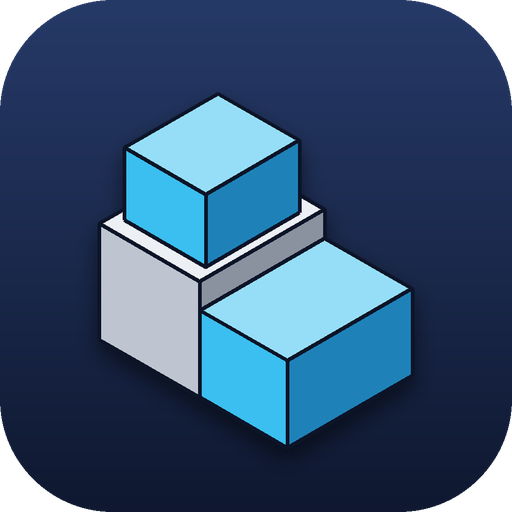
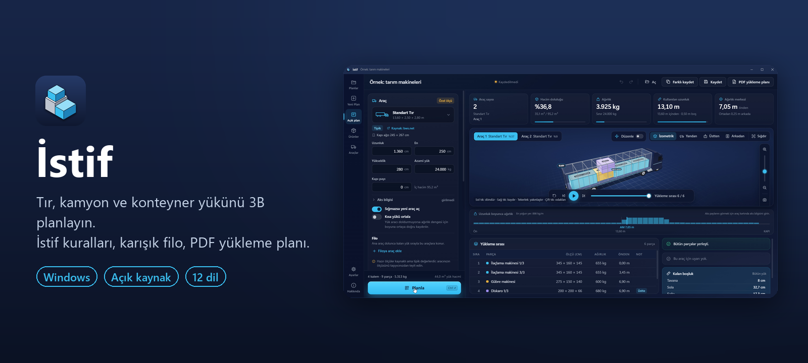
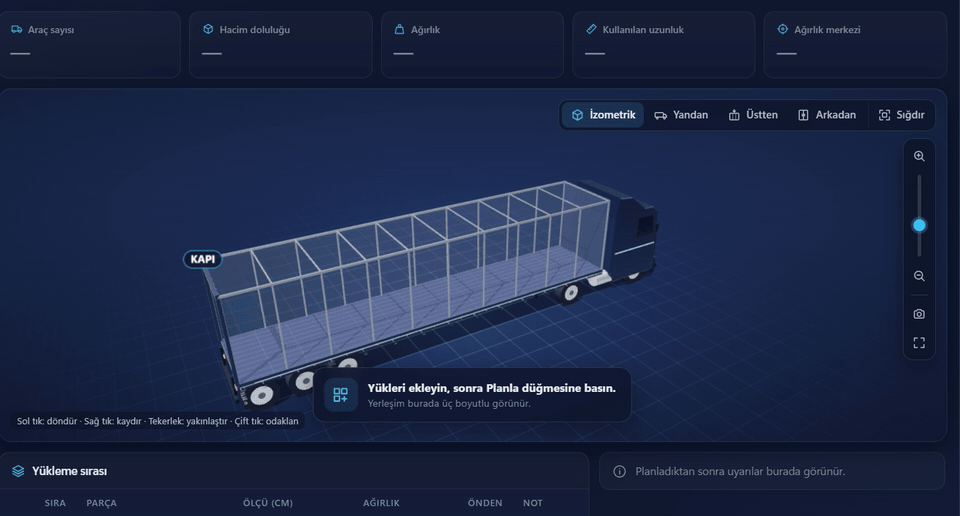
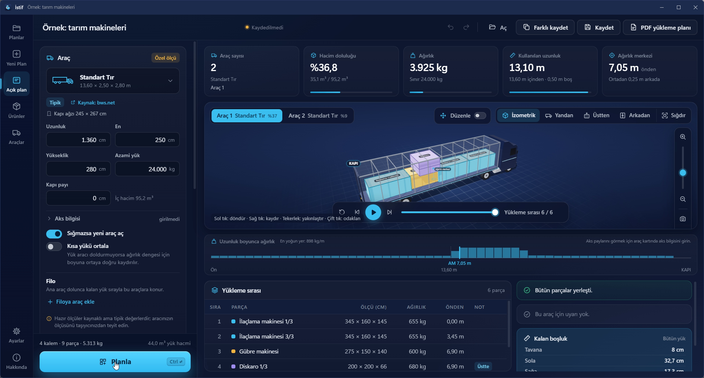
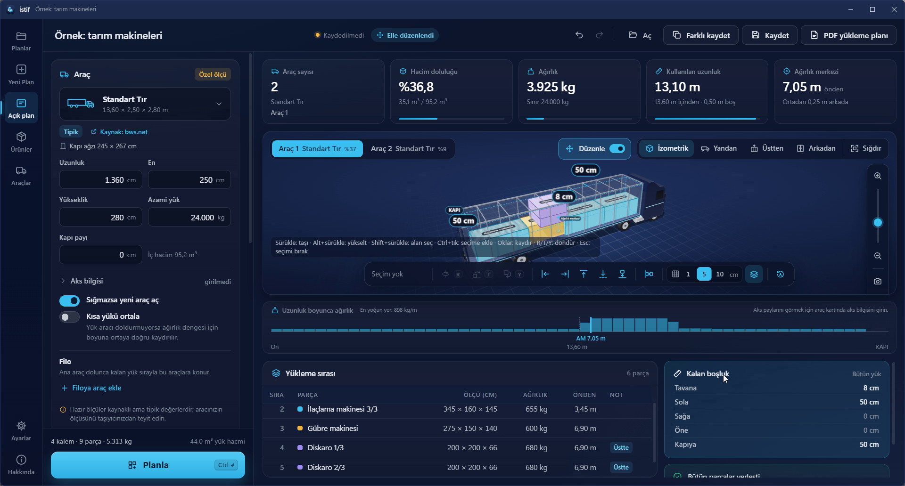
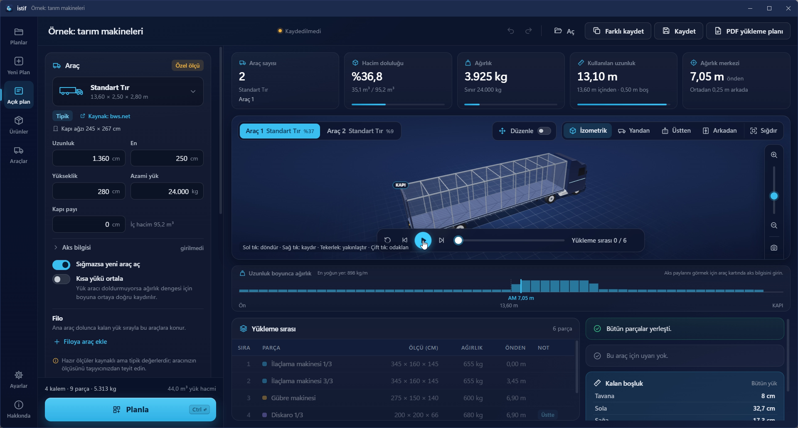
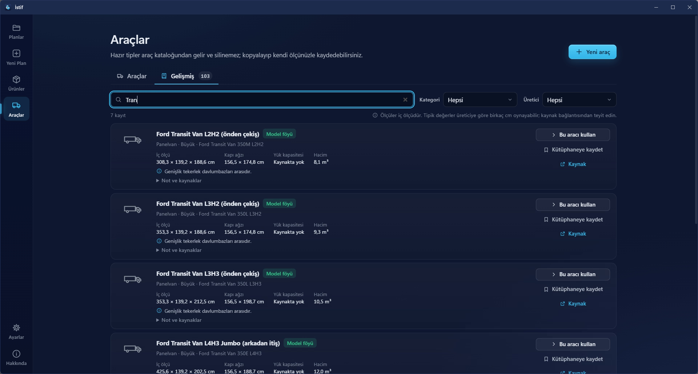
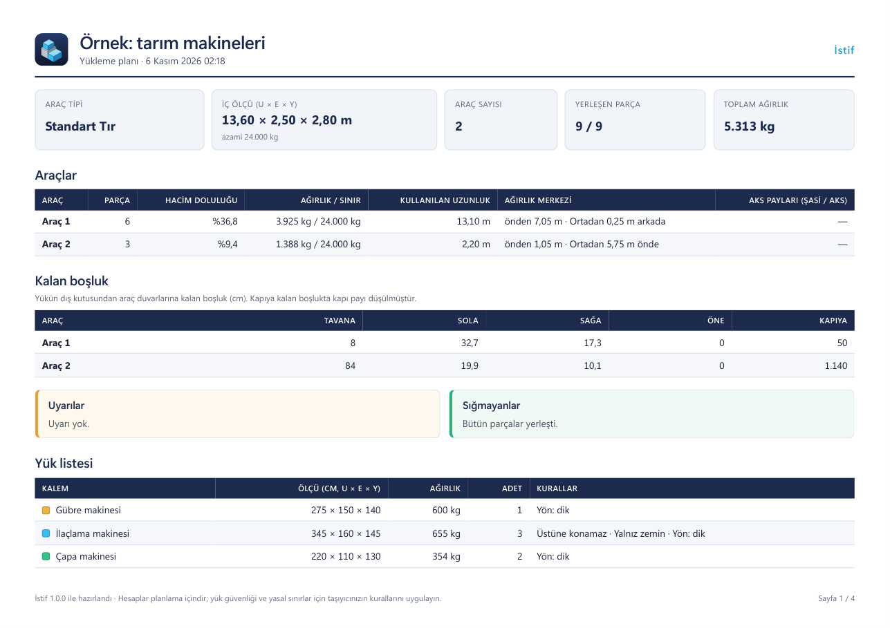

  

<h1 align="center">İstif</h1>

Tır, kamyon ve konteyner yükünü 3B planlayın. Aracı girin, yükü ekleyin, yüklemeyi adım adım izleyin, sonra elle ince ayar yapın.

<a href="README.md">English</a>

  

Kurulum · <a href="https://github.com/ceceys/istif/releases/latest/download/Istif.exe">Taşınabilir exe</a> · <a href="https://github.com/ceceys/istif/releases/latest">Bütün dosyalar</a>

**İstif**, Windows için ücretsiz ve açık kaynak bir yükleme planlayıcısıdır. Aracın ölçüsünü ve yükleyeceğiniz makine, kasa ve kolileri girersiniz. İstif bunları 3B yerleştirir, kaç araç gerektiğini söyler ve yükleme sırasını parça parça gösterir. Farklı bir düzen isterseniz parçaları elle taşıyıp çevirir, ne kadar yer kaldığını görürsünüz.

## Neden yapıldı

İş yerinde bir tır yüklemesi planlanıyordu. Yük tarım makineleriydi ve ilaçlama makineleri üst üste konamıyordu. Standart bir tıra sığmadı; tır ölçüsünün serbestçe girilebildiği iyi bir araç da bulamadım. İstif bu ihtiyaçtan doğdu.

— Cuma Ali Dirik

## Özellikler

- **Her araç**: Tır, kamyon ya da konteynerin ölçüsünü yazın ya da yerleşik katalogdan konteyner, dorse, panelvan ve vagon seçin. Katalogdaki her kaydın kaynağı görünür.
- **Parça başına kural**: Üstüne konamaz, yalnız zemin, üst yük sınırı (kg), yön kilidi (serbest / dik / sabit) ve teslimat sırası.
- **Açık planlama sırası**: Önce en az araç, sonra en kısa kullanılan boy, sonra dengeli ağırlık. Aynı girdi aynı planı verir.
- **Karışık filo**: Tır dolunca kalan yük daha küçük bir araca gidebilir. Kapı payı ve aks dengesi için "kısa yükü ortala".
- **3B görünüm**: Parçalar yükleme sırasıyla adım adım yerine iner. Yakınlaştırma, parçaya odaklanma, yan / üst / arka görünüm, tam ekran, PNG kaydetme.
- **Elle düzenleme**: Bir ya da birden çok parçayı seçin, sürükleyin, çevirin (R / T / Y), duvara yaslayın. İstif her hareketi anında denetler: çakışma, taşma, havada kalma ve istif kuralları kırmızı yanar.
- **Kalan boşluk**: Seçili parçalardan ya da bütün yükten tavana, sol ve sağ duvara, ön duvara ve kapıya kaç cm kaldığını görün.
- **Ağırlık merkezi ve aks payı**: Tahmini olarak, araç boyunca ağırlık dağılımıyla birlikte gösterilir.
- **PDF yükleme planı**: Depo ve şoför için; yükleme sırası ve kalan boşluk dahil.
- **Excel ya da CSV'den alma**: Sütun eşleme ve birim seçimiyle.
- **12 dil**: Türkçe, English, Deutsch, Français, Español, Italiano, Português, Русский, العربية, 中文, 日本語, 한국어.
- **Koyu, açık ya da sistem teması**, metrik ya da imperial birim, geri al / yinele, otomatik taslak.
- **Gizlilik**: Program yalnız güncelleme denetimi için internete çıkar. Plan ve yük verisi hiçbir yere gönderilmez.

## Kurulum

1. **[Istif-Setup.exe'yi indirin](https://github.com/ceceys/istif/releases/latest/download/Istif-Setup.exe)** ve çalıştırın.
2. İstif'i Başlat menüsünden açın.

Kurulumsuz seçenek: [Istif.exe](https://github.com/ceceys/istif/releases/latest/download/Istif.exe), tek dosya. Bütün sürümler [Releases](https://github.com/ceceys/istif/releases) sayfasında.

Program kod imzalı olmadığı için Windows SmartScreen uyarı verebilir: uyarı penceresinde ek bilgi bağlantısına, ardından çıkan çalıştırma düğmesine tıklayın.

## İlk kullanım

1. Açılış ekranında **örneklerden** birini açıp hazır bir plana bakın.
2. Ya da **yeni plan** başlatın: aracı seçin, yükü ekleyin, **Planla**'ya basın.
3. 3B görünümde **Oynat**'a basıp yükleme sırasını izleyin.
4. Parçaları elle taşımak ya da çevirmek için **Düzenle**'yi açın.
5. Depo ve şoför için **PDF yükleme planı**nı kaydedin.

Ekran görüntülü tam rehber: [docs/rehber/tr.md](docs/rehber/tr.md) (English: [docs/rehber/en.md](docs/rehber/en.md)).

## Gizlilik

- İstif yalnız yeni sürüm için GitHub'a bakar, günde en fazla bir kez. Bir şey indirilmeden önce size sorulur; dosya kurulmadan önce `SHA256SUMS.txt` ile doğrulanır. Denetim Ayarlar'dan kapatılabilir.
- Planlarınız, araçlarınız ve yük listeleriniz bilgisayarınızda kalır.
- Plan dosyaları seçtiğiniz yere `.istif` uzantısıyla kaydedilir.

## Sistem gereksinimleri

- Windows 10 ya da 11 (64 bit)
- [.NET 8 Desktop Runtime](https://dotnet.microsoft.com/download/dotnet/8.0) (x64)
- Microsoft Edge WebView2 Runtime (Windows 11'de yüklü gelir)

## Not

Hesaplar planlama içindir. Yük güvenliği ve yasal sınırlar için taşıyıcınızın kurallarını uygulayın. Katalogdaki araç değerleri belirtilen kaynaklardaki tipik ya da model değerleridir; kendi aracınızı kontrol edin.

## Geri bildirim ve katkı

Hata bildirimi, öneri ve çeviri düzeltmeleri memnuniyetle karşılanır. Bir [issue](https://github.com/ceceys/istif/issues/new/choose) açın ya da [CONTRIBUTING.md](CONTRIBUTING.md) dosyasına bakın.

## Geliştiriciler için

Derleme, klasörler, diller ve sürüm yayınlama İngilizce [README.md](README.md) dosyasının "For developers" bölümünde.

## Lisans

[MIT](LICENSE). Açık kaynak bileşenler: [three.js](https://threejs.org/) (MIT), [SheetJS](https://sheetjs.com/) (Apache-2.0), Microsoft WebView2 SDK (BSD-3-Clause).

## Geliştiren

Cuma Ali Dirik, Bilişim Teknolojileri Uzmanı · [LinkedIn](https://www.linkedin.com/in/cuma-ali-dirik) · [GitHub](https://github.com/ceceys)
