# İstif user guide

İstif is a free, open source load planner for Windows. It places the machines, crates and boxes that go on a truck, lorry or container in 3D. This guide covers every step, from install to the PDF plan.

Türkçe: [tr.md](tr.md)

## Contents

1. [Install and first start](#1-install-and-first-start)
2. [Know the interface](#2-know-the-interface)
3. [Quick start: your first plan](#3-quick-start-your-first-plan)
4. [Choosing a vehicle and custom size](#4-choosing-a-vehicle-and-custom-size)
5. [Mixed fleet](#5-mixed-fleet)
6. [Load list and rules](#6-load-list-and-rules)
7. [Product and vehicle library](#7-product-and-vehicle-library)
8. [The 3D view](#8-the-3d-view)
9. [Editing by hand](#9-editing-by-hand)
10. [Reading the result](#10-reading-the-result)
11. [PDF loading plan](#11-pdf-loading-plan)
12. [Importing a load from Excel](#12-importing-a-load-from-excel)
13. [Saving and opening plans](#13-saving-and-opening-plans)
14. [Language, theme and settings](#14-language-theme-and-settings)
15. [Updates](#15-updates)
16. [Shortcuts](#16-shortcuts)
17. [FAQ](#17-faq)
18. [Limits and responsibility note](#18-limits-and-responsibility-note)

Button and menu names in this guide are the English labels of the interface, written in bold.

---

## 1. Install and first start

**Requirements**

- Windows 10 (version 1809 or newer) or Windows 11. Only 64-bit Windows is supported.
- .NET 8 Desktop Runtime (x64).
- Microsoft Edge WebView2 Runtime. It comes with Windows 11.

**With the installer**

1. Download [Istif-Setup.exe](https://github.com/ceceys/istif/releases/latest/download/Istif-Setup.exe).
2. Run it and follow the steps.
3. Open İstif from the Start menu.

What to know about the installer:

- By default it installs only for your own user account and does not ask for administrator rights. At the start of the setup a window may offer to install for all users. If you choose that, Windows may ask for administrator permission.
- The installer does not include .NET. At the start it checks for the .NET 8 Desktop Runtime and the WebView2 Runtime. If one is missing, the setup stops and offers to open Microsoft's download page in your browser. The setup itself downloads nothing. From that page, download and install ".NET Desktop Runtime 8" (x64), or for WebView2 the "Evergreen Bootstrapper" or "Evergreen Standalone Installer". Then start the İstif setup again.
- A Start menu shortcut is added. A desktop shortcut is optional.
- The `.istif` extension is linked to İstif. Double-clicking a plan file opens it in İstif (section 13).
- When you uninstall, your plans, library and settings stay where they are (section 13).

**Windows SmartScreen warning**

The İstif files are not code-signed. Because of this, Windows SmartScreen may show a "Windows protected your PC" warning. This is expected. To continue, click **More info**, then **Run anyway**. Download the file only from the project's [GitHub releases page](https://github.com/ceceys/istif/releases/latest). The same page has a `SHA256SUMS.txt` file; you can compare the SHA-256 checksum of your download with the one listed there.

**With the portable version**

1. Download [Istif.exe](https://github.com/ceceys/istif/releases/latest/download/Istif.exe). It is a single file with no installation.
2. The .NET 8 Desktop Runtime and the WebView2 Runtime must be installed. The portable version needs them too.
3. Run the file from any folder.

The portable version does not add a Start menu shortcut and does not link the `.istif` extension to İstif; those come with the installer. Your plans and settings are stored in the same places.

If WebView2 is missing, the program shows "This program needs the Microsoft Edge WebView2 Runtime" when it starts. On Windows 10, install the "WebView2 Runtime" from Microsoft's website and open the program again.

**First start**

A short splash screen appears, then the **Plans** screen. On the first start, the language follows the display language of Windows. If the Windows language is not one of İstif's 12 languages, İstif opens in English (section 14).

On the **Plans** screen, the **Welcome** heading is at the top with the **New load plan** and **Open plan…** buttons. Below it is the **Example loads** section with four example cards, and below that the **Recent plans** list. If you have not saved a plan yet, this section says **No saved plans yet** and shows three steps: **Choose the vehicle**, **Enter the load**, **Plan**. If the open plan has items or was opened from a file, an **Open plan** card with a **Back to plan** button also appears.

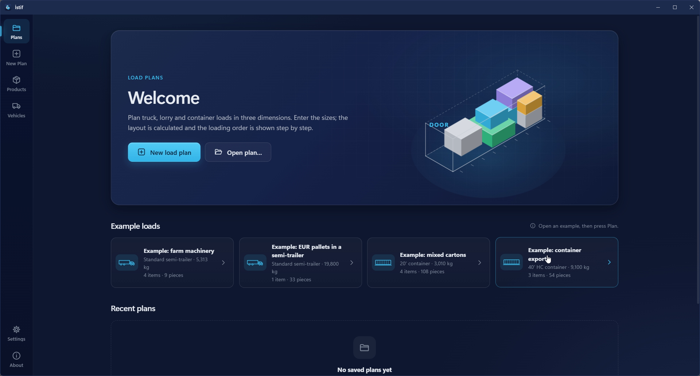

---

## 2. Know the interface

**The side rail.** A vertical rail runs down the left side of the window. At the top are **Plans**, **New Plan**, **Open plan**, **Products** and **Vehicles**. **Open plan** appears only while a plan is open. At the bottom are **Settings** and **About**. Language, theme and units are changed on the **Settings** screen (section 14); the plan screen has no separate buttons for them.

The **plan screen** (**Open plan**) has these parts:

- **Top bar.** On the left is the plan name (click it to rename) and next to it the **Not saved** or **Saved** status. When the plan was edited by hand, an **Edited by hand** label appears, and when there are errors, a **The plan has … errors** label. On the right are the undo and redo icons and the **Open**, **Save as**, **Save** and **PDF loading plan** buttons. The **PDF loading plan** button stays dimmed until the plan is calculated.
- **Left column.** At the top is the **Vehicle** card (vehicle picker, size fields, **Axle data**, two switches, **Fleet**). Below it is the **Load list** card (**Add item**, **Add from products**, **Import from Excel**). A fixed strip at the bottom of the column shows the item count, piece count and total weight, and the large **Plan** button.
- **Summary cards.** Five cards at the top of the right side: **Vehicles**, **Volume used**, **Weight**, **Length used**, **Centre of gravity**. Before the plan is calculated they are empty (—).
- **3D area.** Below the summary cards. Above it are the vehicle tabs (when there is more than one vehicle), the **Edit** switch and the view buttons. On the right edge are the zoom buttons and slider, the camera (save PNG) and full screen buttons. Along the bottom is the playback bar.
- **Weight along the length** strip, below the 3D area.
- **Loading order** table, at the bottom left. To its right is the warnings column: **Not loaded**, **Warnings** and **Free space**.

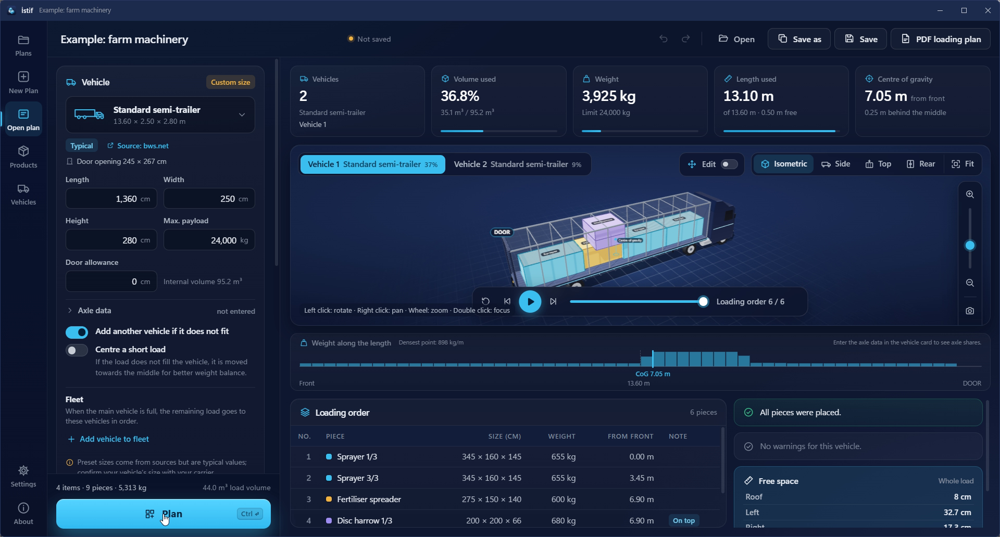

---

## 3. Quick start: your first plan

The easiest start is the built-in example.

1. On the **Plans** screen, under **Example loads**, click the **Example: farm machinery** card. The plan opens. It has a fertiliser spreader, a sprayer, a rotary hoe and a disc harrow (4 items, 9 pieces).
2. Opening the example does not plan it. The 3D area says "Add the load, then press Plan."
3. Look at the **Vehicle** card on the left: you see the chosen vehicle and its size.
4. Look at the **Load list**. Each item shows its size, weight, quantity and rules.
5. Press **Plan** (shortcut: `Ctrl + Enter`). While it calculates, the button says **Calculating**. When it ends, the placement appears in the 3D area. This example does not fit one truck; because the **Add another vehicle if it does not fit** switch is on, İstif opens a second vehicle and the **Vehicle 1** and **Vehicle 2** tabs appear above the 3D area.
6. Press **Play**. The pieces drop into place in loading order.
7. Point at a piece: its **Size**, **Weight**, **Order** and **Position** appear.
8. In the summary cards at the top, read the vehicle count, the volume used and the centre of gravity.

For your own plan:

1. Choose **New Plan** in the side rail. The plan opens with the default vehicle from **Settings**; if you did not change it, this is the Standard semi-trailer.
2. Choose the vehicle or enter its size (section 4).
3. Add the load items (section 6).
4. Press **Plan**.

To plan you need at least one load item. The length, width and height of the vehicle (and of any fleet vehicles) and the sizes of every item must also be filled in. If something is missing, İstif tells you. For example: "Add at least one load item to plan."

If you change the load or the vehicle, the result is out of date. A label above the 3D area says "Inputs have changed. Plan again for an up-to-date result." Press **Plan** again.

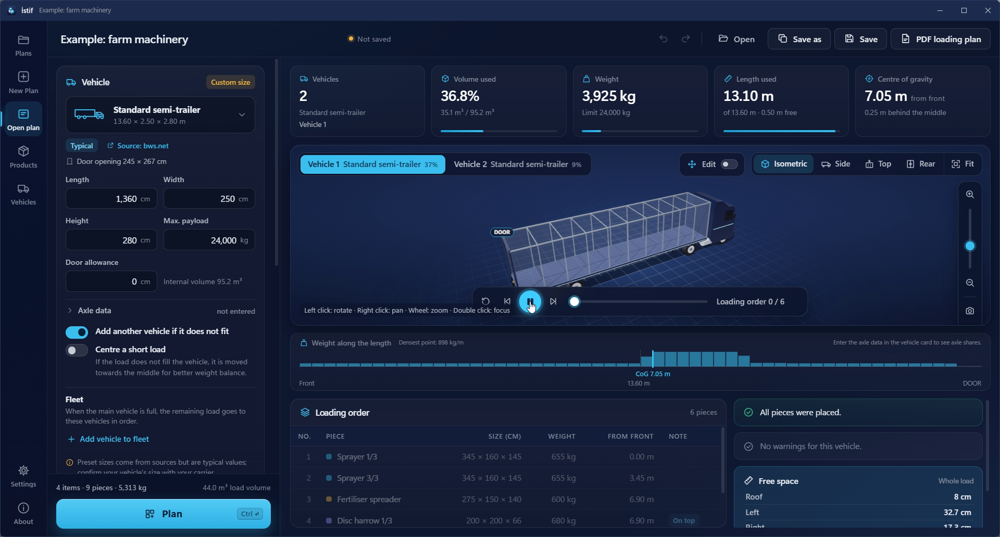

---

## 4. Choosing a vehicle and custom size

**Preset types**

Click the vehicle picker at the top of the **Vehicle** card. In the list, the **Preset types** group contains: Standard semi-trailer, Mega semi-trailer, 20' container, 40' container, 40' HC container and Panel van (Ford Transit L3H2). Vehicles you saved yourself are in the **My vehicles** group. At the end of the list is **Advanced catalogue…** (section 7).

Under the chosen type you see:

- A **Typical** or **Model sheet** label. **Typical**: from a standard or the common value of several sources; it may vary by a few cm between makers. **Model sheet**: taken from the data sheet of a specific model.
- A **Source** link. It opens in your default browser.
- The **Door opening** size (width × height).
- For the panel van, the note "Width is measured between the wheel arches."

Preset sizes come from sources but are typical values. Ask your carrier for the real inner size of your vehicle.

**Custom size**

In İstif you can enter the vehicle size freely. Fill in the fields on the **Vehicle** card:

| Field | Meaning |
|---|---|
| **Length** | Inner length of the load space |
| **Width** | Inner width |
| **Height** | Inner height |
| **Max. payload** | The most weight the vehicle may carry. If you enter 0 or leave it empty, no weight limit is applied. |
| **Door allowance** | Space kept free at the rear door |

The fields use the unit system chosen in **Settings**: cm and kg for metric, in and lb for imperial (section 14). If you enter sizes that differ from the chosen type, a **Custom size** label appears at the top of the card. When you enter the size, the **Internal volume** is shown next to the fields.

Some catalogue records have no payload in their source. Then the **Max. payload** field stays empty and the warning "Payload is not given in the source; enter your vehicle's value." appears.

**Door allowance**

Enter in **Door allowance** the distance that must stay free at the rear door. İstif places no pieces in that zone. On a vehicle with a door allowance, the weight strip below the 3D area marks that zone (section 10).

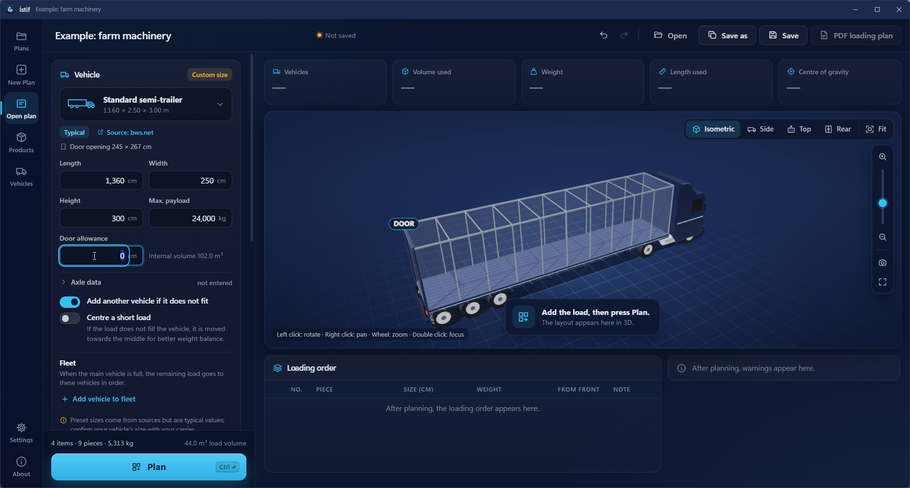

**Axle data (optional)**

Click the **Axle data** row on the **Vehicle** card to open two fields. The same fields are also in the vehicle editor on the **Vehicles** screen.

- **King pin**: measured from the front wall.
- **Middle of axle group**: measured from the front wall. It must be behind the king pin.

If you enter both values, İstif estimates the load share on the king pin and on the axle group (in kg). If no axle data is entered, no axle share is shown; the row says **not entered**. Preset types have no axle data; you enter it yourself. If one of the values is missing, if the axle group is ahead of the king pin or at the same point, or if it is more than 5 m beyond the vehicle length, the warning "Enter both axle values; the axle group must be behind the king pin." appears.

**Saving your own vehicle**

If you save the size you entered with **Save to my vehicles** at the bottom of the card, you can pick it from the **My vehicles** group of the vehicle picker in later plans (section 7).

---

## 5. Mixed fleet

When one vehicle is full, a smaller vehicle may be enough for the rest of the load instead of a second vehicle of the same type. İstif does this with the **Fleet**.

**First, the two switches**

The **Vehicle** card has two switches:

- **Add another vehicle if it does not fit**: if the load does not fit one vehicle, İstif opens a new one. While the switch is on (the default for new plans), vehicles are added as needed. While it is off, only the vehicles you chose are used; pieces that do not fit go to the **Not loaded** list (section 10).
- **Centre a short load**: if the load does not fill the vehicle, it is moved towards the middle for better weight balance. It is explained in section 10.

**How to build a fleet**

1. On the **Vehicle** card, go to the **Fleet** section. Its description: "When the main vehicle is full, the remaining load goes to these vehicles in order."
2. Click **Add vehicle to fleet**. In the window that opens, pick a vehicle from the preset types, from **My vehicles** or from **Advanced catalogue…**.
3. The list builds up: row 1 is the **Main vehicle**. The vehicles you add are numbered 2, 3… You can add at most 8 vehicles on top of the main one; at the limit the button disappears.
4. To change the order, drag a row, use the up and down arrows on the row, or press `Alt + ↑/↓` while the row is focused. The cross button (or `Delete`) removes a vehicle from the list.
5. Press **Plan**.

**How the vehicles are used**

- Vehicles are used in list order. If **Add another vehicle if it does not fit** is on, the last type in the list repeats as needed. If it is off, each vehicle in the list is used once.
- If a piece cannot fit the next vehicle at all because of its size or weight, that vehicle is skipped and the piece goes to the next suitable one.
- A vehicle that receives no pieces does not appear in the result.
- Once the fleet has at least one vehicle, the **Choose the best vehicle for the remaining load** switch appears. When it is on, the first vehicle is still the first type in the list. For the remaining load, every type in the list is tried; the type that takes the rest in the fewest vehicles (and, if the count is equal, with the shortest total length) is chosen. If **Add another vehicle if it does not fit** is on, the chosen type repeats as needed. If it is off, each type is tried as the second vehicle, and the remaining vehicles are used once each, in list order.

**The result**

In the result, each vehicle has its own tab. The tab shows the vehicle's type and fill percentage (section 10). Under **Vehicles** in the summary cards, the type name is shown. In the PDF, each vehicle's name (if the types differ) and its own weight limit are shown separately (section 11).

**When it helps**

Example: most of the load fits one truck and a few boxes are left over. A smaller vehicle may be enough for those boxes instead of a second truck.

---

## 6. Load list and rules

**Adding an item**

1. On the **Load list** card, click **Add item**. The **Add load item** window opens.
2. Fill in:
   - **Name** (e.g. Fertiliser spreader)
   - **Reference** (optional)
   - **Sizes**: **Length**, **Width**, **Height**
   - **Weight (per piece)**
   - **Quantity**
   - **Colour**: one of ten ready colours, or a colour of your own. It helps you tell pieces apart in 3D.
   - **Orientation**: **Free**, **Upright** or **Fixed**
   - **Rules**: explained below
3. Click **Save**. The item is added to the list. **Cancel** closes the window.

Missing or wrong fields are marked in the window: "Enter a name.", "Length, width and height must be greater than zero.", "Quantity must be at least 1." and so on.

If you add or change an item in a plan that is already planned, the result becomes out of date; press **Plan** again.

The strip at the bottom of the left column shows the item count, piece count, total weight and load volume. In the list, each item shows its name, quantity, size, weight and rule labels. If the vehicle's door opening is known and the item's two smallest sizes are larger than the door opening, the item gets a red **Does not fit the door** label.

To edit an item, click its row (or press `Enter`) or use the **Edit** icon on the row. To delete it, click the **Delete** icon (or press `Delete`). After deleting, an **Undo** option is shown for a few seconds.

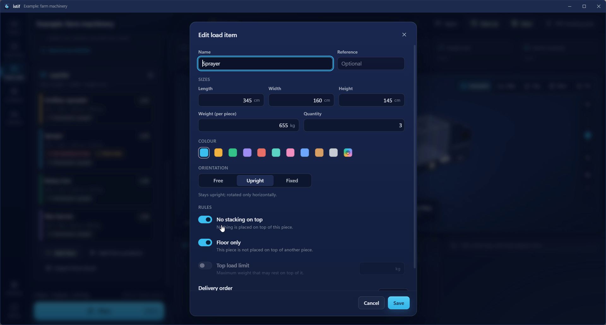

### Rules: which one, and when

**No stacking on top**

Nothing is placed on top of this piece. Use it for fragile pieces, or pieces that must not carry any weight.

Example: sprayers cannot be stacked. Set the sprayer item to **No stacking on top**. No piece goes on top of it, so sprayers do not end up on each other. While this rule is on, **Top load limit** is switched off because it would have no meaning.

**Floor only**

This piece is never placed on another piece; it sits only on the vehicle floor. Use it for heavy pieces or pieces with a narrow base.

Example: a disc harrow set to **Floor only** will not be lifted onto a crate.

**Top load limit**

The most weight (kg) that may rest on top of this piece. Use it when you want the piece to carry a load, but only up to a limit. The limit applies to the total weight of all pieces standing on it, directly or indirectly.

Example (values are only for illustration): if a crate has a top load limit of 100 kg, a 150 kg piece is not placed on it; an 80 kg piece can be.

**Orientation**

| Orientation | Meaning | When to use |
|---|---|---|
| **Free** | Can be rotated in any direction. | Boxes and flat crates. |
| **Upright** | Stays upright; rotated only horizontally. | Pieces marked "this side up" that must not tip. |
| **Fixed** | Never rotated; loaded as entered. | Machines whose direction must not change. |

The orientation rule also applies when you edit by hand (section 9).

**Delivery order**

In multi-stop shipments, higher numbers are loaded first (go to the front). Leave 0 for a single stop. Numbers above 0 appear in the list with a **Stop …** label. When you edit by hand, if you put a piece that is unloaded later in front of a piece that is unloaded earlier, a yellow **Delivery order** warning appears (section 9).

---

## 7. Product and vehicle library

**Products**

Keep the products you load often, with their sizes and rules. The library starts with some example products: fertiliser spreader, sprayer, rotary hoe, disc harrow, EUR pallet (120 × 80) and industrial pallet (120 × 100). The height and weight values of the pallet products are only starting values; adjust them to your own load.

1. Go to **Products** in the side rail.
2. Click **New product** and fill in the fields. The product window has no **Quantity** or **Delivery order**; those belong to an item in a plan.
3. On the plan screen, choose **Add from products**, find the product (**Search products**), set the quantity and click **Add**. The window stays open; you can add several products and then press **OK**.

On the **Products** screen, a product's **Add to plan** button adds one piece of it to the open plan. Clicking a product row opens it for editing. Deleting asks for confirmation; a product deleted from the library does not change items already in plans. When you add a load item, turn on **Also save to the product library** to put it in the library too.

**Vehicles**

The **Vehicles** screen has two tabs: **Vehicles** and **Advanced**.

The **Vehicles** tab has two groups: **My vehicles** and **Preset types**.

- Preset types cannot be deleted. Use **Copy** to copy one and save it with your own size.
- **New vehicle** lets you add a vehicle from scratch: name, type, internal size, max. payload, door allowance and optional axle data. A new vehicle starts with the sizes of the Standard semi-trailer.
- **Use in plan** puts the vehicle into the open plan. If no plan is open, a new one is opened.
- The **Type** (Semi-trailer, Truck, Van, Container) sets the vehicle model in the 3D view.
- Vehicles under My vehicles can be edited and deleted.

The **Advanced** tab is the whole vehicle catalogue (the tab shows the record count). It has a search box and **Category** and **Maker** filters. The catalogue categories are Container, Semi-trailer, Panel van and Rail (the category list shows only categories that have records in the catalogue). Each record shows the internal size, door opening, payload, volume, a **Typical** or **Model sheet** label and a source link. **Use this vehicle** puts the record into the plan, **Save to library** adds it to **My vehicles**. The same catalogue also opens as a window from **Advanced catalogue…** at the end of the vehicle picker on the plan screen.

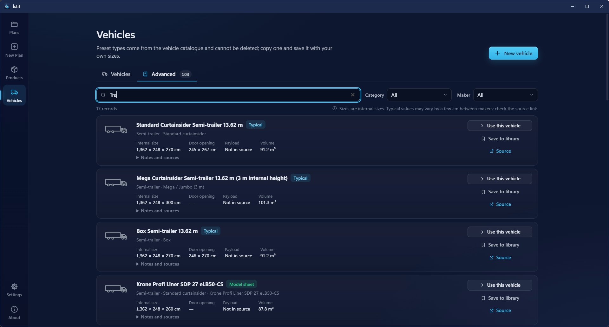

**Exporting and importing the library**

In the **Data** section of the **Settings** screen, **Export library** saves your product and vehicle library to a JSON file (`istif-library.json`). **Import library** reads such a file and asks: **Add** to the current library, or **Replace** the library with it.

---

## 8. The 3D view

The 3D area shows the placement. In plans with several vehicles, each vehicle has its own tab.

**Moving around with the mouse**

The hint in the 3D area reads: "Left click: rotate · Right click: pan · Wheel: zoom · Double click: focus".

- **Drag** (left button): rotate.
- **Right button**: pan.
- **Wheel**: zoom in and out.
- **Double click on a piece**: the camera focuses on that piece. A double click on empty space fits the vehicle in the frame.

**View buttons**

At the top right of the 3D area are five buttons, each with an icon and a name:

| Button | What it shows |
|---|---|
| **Isometric** | A diagonal view from the side and above |
| **Side** | The side of the vehicle |
| **Top** | A bird's-eye view |
| **Rear** | A view from the door (the door is marked **DOOR**) |
| **Fit** | Fits the vehicle in the frame |

**Zoom, PNG and full screen**

On the right edge of the 3D area, from top to bottom: the **Zoom in** button, the zoom slider, the **Zoom out** button, **Save image as PNG** (camera icon) and **Full screen**. While the 3D area is selected, the `+` and `−` keys also zoom in and out. The PNG saves the view you currently see.

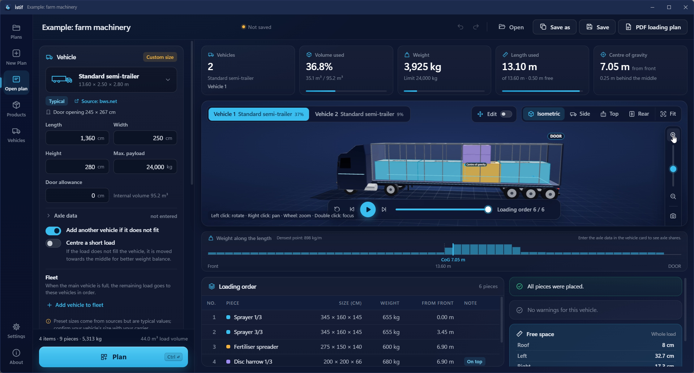

**Step-by-step playback**

The playback bar is at the bottom of the 3D area:

- **Play / Pause**: pieces drop into place in loading order.
- **Previous step / Next step**: move through the order by hand.
- **Back to start**: restart.
- You can also drag the slider next to them to jump to any step.
- A counter such as **Loading order 3 / 12** appears (numbers are an example).
- While the 3D area is selected, the `Space` key plays and pauses.

During playback, rows of the **Loading order** table that are not loaded yet look faded and the current row is highlighted.

**Selecting a piece**

- Point at a piece to see its **Size**, **Weight**, **Order** and **Position** (for example "9.65 m from the front, 0.00 m above the floor"). It also says "On top of another piece" if the piece sits on another piece, and "Placed rotated" if it was turned to fit.
- Click a piece: it is highlighted and the others fade.
- Click an empty spot to clear the selection.
- Clicking a row in the **Loading order** table also selects that piece; clicking the same row again clears the selection. Double-clicking a row focuses the camera on that piece.

If the 3D view cannot open, it says "The 3D view could not start on this computer. Results are shown in the table."

---

## 9. Editing by hand

İstif places the pieces itself. If you want a different layout, you can move, rotate and push pieces against a wall by hand. İstif checks every move at once and shows how much space is left in the vehicle.

**Turning it on**

After the plan is calculated, turn on the **Edit** switch above the 3D area. (The switch does not appear while there is no result.) When it is on:

- The edit bar replaces the playback bar. All pieces are visible and the loading animation stops.
- The hint changes to: "Drag: move · Alt+drag: lift · Shift+drag: select area · Ctrl+click: add to selection · Arrows: nudge · R/T/Y: rotate · Esc: clear selection".
- Once the plan is changed by hand, an **Edited by hand** label appears in the top bar.

When you turn the switch off, the view goes back to normal; your changes stay in the plan.

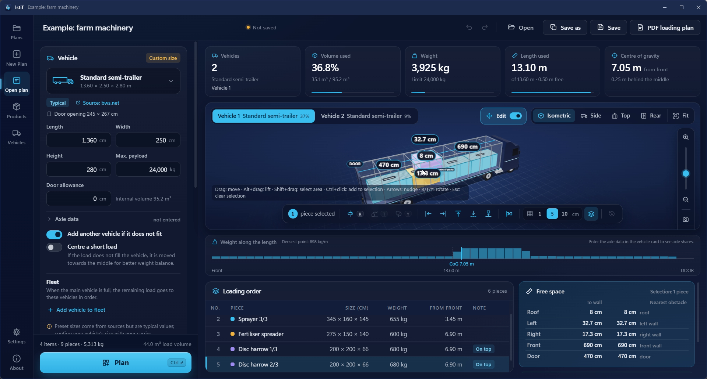

**Selecting**

- **Click**: selects a piece. Clicking empty space clears the selection.
- **Ctrl+click**: adds the piece to the selection or removes it. This is how you select several pieces.
- **Shift+drag**: selects the pieces inside a rectangle. If `Ctrl` is also held, they are added to the current selection.
- **Esc**: clears the selection.
- The rows of the **Loading order** table follow the 3D area: a piece you select in the table is selected in 3D too. While editing, you can also add to the selection with `Ctrl+click` in the table.
- **Select the stack too**: while this option is on (the default), selecting a piece also selects the pieces standing on top of it, and they move together. You switch it on and off with the button of the same name in the edit bar.
- On the left of the edit bar, the number of selected pieces is shown: "1 piece selected" or "Nothing selected".

With editing off, a click selects a single piece and fades the others. With editing on, the others do not fade, so you can see what is in the way.

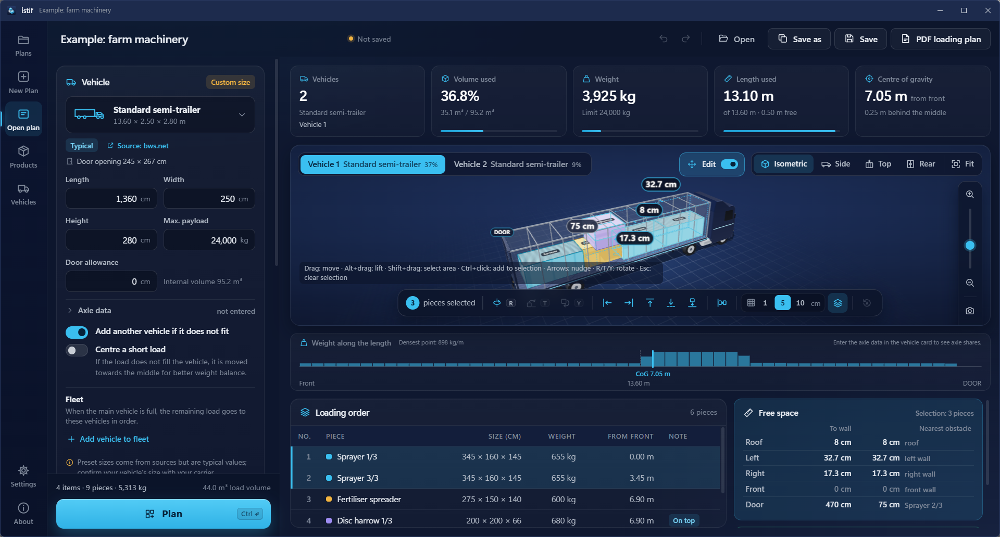

**Moving**

- **Drag**: the piece (or the selected group) moves on the vehicle floor plane, that is left-right and forward-back.
- **Hold Alt and drag**: the piece moves up and down.
- While you drag, the place where you will drop it is shown with a semi-transparent frame.
- When you let go, the piece snaps to the **grid step**, clings to nearby walls and to the faces of neighbouring pieces, and cannot leave the vehicle. Then it settles on the surface below; a piece you drop in the air comes down to the floor or onto the piece under it.
- The **Grid step** is chosen in the edit bar: 1, 5 or 10 cm (1, 2 or 4 in for imperial). The default is 5 cm. Your choice is remembered the next time you open the program.
- **Arrow keys** nudge the selected piece by one grid step; the direction follows the camera view. With `Shift` they move ten steps. `Page Up` and `Page Down` move it up and down.

**Rotating**

The edit bar has three rotate buttons. The same letters work on the keyboard:

| Button | Key | What it does |
|---|---|---|
| **Turn 90° flat** | `R` | Turns the piece 90° in place, flat. |
| **Tip onto its side** | `T` | Tips the piece onto its side. |
| **Tip forward** | `Y` | Tips the piece forward. |

The piece's **Orientation** rule is respected: on a **Free** piece all three work, on an **Upright** piece only `R`, on a **Fixed** piece none. A button that does not work looks grey; point at it and it tells you why, for example "Sprayer" must not be rotated (orientation: fixed). If several pieces are selected, they turn together around their common centre. Rotation is animated.

**Pushing**

The five icon buttons next to the rotate buttons push the piece. In order: **Push to the left wall**, **Push to the right wall**, **Push to the front (towards the cab)**, **Push to the back (towards the door)**, **Lower to the floor**. If nothing is selected, the whole load moves. If there is no room in that direction, it says "There is no space in this direction."

**Close the gap** pushes the selection, or the whole load if nothing is selected, to the front towards the cab.

The buttons with text in the edit bar (**Close the gap**, **Select the stack too**, **Back to automatic plan**) shrink to icons when the window is narrow. Point at an icon to see its name; the names of the push and rotate buttons are always shown only when you point at them.

**Free space and dimension lines**

How many cm are left from the selected piece (or group) to the roof, the left, the right, the front and the door is shown in two places:

- In the 3D area, as dimension lines with labels.
- In the **Free space** panel at the bottom right, as a list. With a selection, the top of the panel says something like "Selection: 1 piece" and there are two columns: **To wall** and **Nearest obstacle**. The nearest obstacle column gives the name of the obstacle: another piece, or roof, left wall, right wall, front wall, door. The rows are **Roof**, **Left**, **Right**, **Front**, **Door**.
- With no selection, the panel says **Whole load** and shows the space from the outer box of the whole load to the vehicle walls.
- The numbers change live while you drag.
- If the vehicle has a door allowance, it is deducted from the space to the door: "The door allowance is deducted from the space to the door."
- If there are no pieces in the vehicle, it says "There are no pieces in the vehicle."

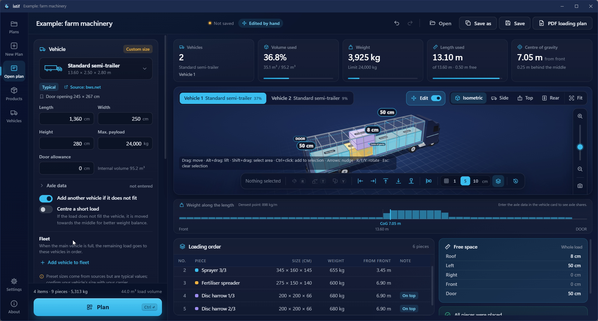

**Live check and red warning**

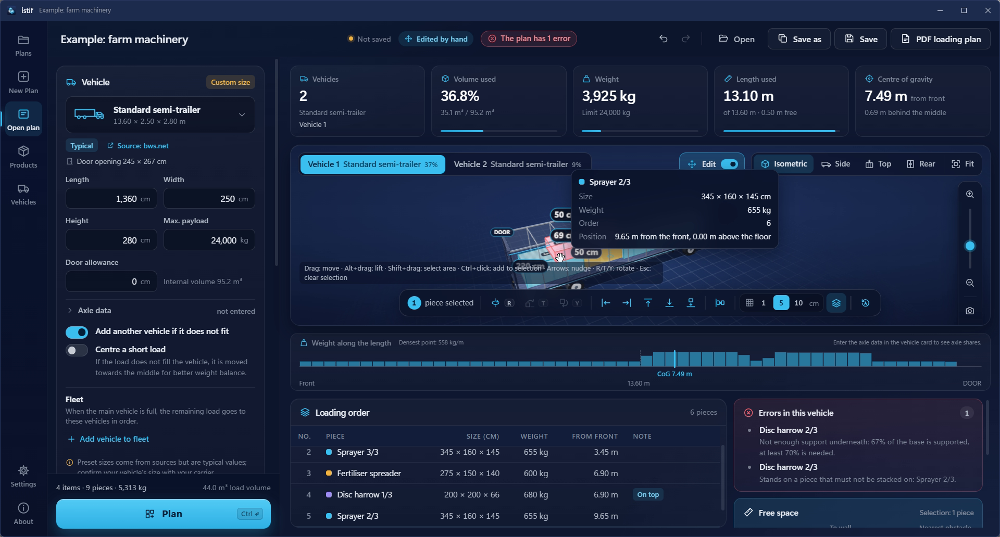

After every change İstif checks the whole layout.

- A piece that breaks a rule turns **red** and shakes slightly.
- The **Errors in this vehicle** box at the bottom right gives the piece's name and the reason. If you click a line, the piece is selected and the camera turns to it.
- In the **Loading order** table, the piece gets an **Error** label in its note.
- A **The plan has … errors** label appears in the top bar. If you click it, it goes to the first faulty piece.
- The red error reasons are: sticking out of the vehicle, entering the door allowance, overlapping another piece, a piece floating in the air, not enough support underneath (at least 70% of the base must be supported), breaking the floor-only rule, standing on a piece that must not be stacked on, exceeding a top load limit, breaking the rotation rule, the piece sizes no longer matching the item (if the item size was changed after editing by hand), and, for the whole vehicle, exceeding the weight limit.
- The **yellow** warning is only for delivery order: if a piece that is unloaded later blocks a piece that is unloaded earlier, a **Delivery order** box and a **Warning** label in the table appear.

You can still save a plan that has errors and make a PDF of it; the PDF starts with the note "This plan has … errors. Fix them before loading."

After every change, the summary cards, the centre of gravity, the axle shares, the **Weight along the length** strip and the **Loading order** table are recalculated for the new layout.

**Undoing**

- Every manual step goes into the undo history: the undo and redo buttons in the top bar, or `Ctrl + Z` and `Ctrl + Y`. When you undo, the piece glides back to its old place.
- **Back to automatic plan** (the last button in the edit bar) discards all manual changes and returns to the calculated layout. If the plan has not been changed by hand, the button is grey: "The plan has not been changed by hand."
- If you press **Plan** on a plan edited by hand, İstif asks: **Manually edited plan** / "Your manual changes will be lost. Continue?" If you press **Plan again**, the new calculation discards your manual changes.

**Saving and PDF**

A plan edited by hand is saved in the `.istif` file and comes back exactly as it was; the check runs again when the plan is opened. The PDF is made with the new layout and has a free space table for every vehicle (section 11).

**Animations**

A soft snap on release, sliding moves with the arrow keys, rotating and pushing movements, pieces gliding back on undo and dimension lines fading in are all animated. You can turn this off with the **Animations** option in **Settings** (section 14).

---

## 10. Reading the result

**Summary cards**

| Card | Meaning |
|---|---|
| **Vehicles** | How many vehicles the plan uses. Below it are the selected vehicle's type and (when there is more than one vehicle) its tab name. |
| **Volume used** | The load compared with the vehicle volume (percent). Below it the "used / total" volume is written in m³; if there is a door allowance, it is deducted from the total volume. |
| **Weight** | Total weight of the load on the selected vehicle and the vehicle's limit ("Limit … kg" or "No weight limit"). Above 90% of the limit the bar turns yellow; when the limit is exceeded it turns red. |
| **Length used** | The length the load takes in the load space (where the rearmost piece ends), and how many metres of the total length are free. |
| **Centre of gravity** | How many metres from the front the centre of gravity of the load is. Below it: "Centred lengthwise", or how far ahead of or behind the middle it is. If axle data was entered, **King pin … · Axles …** also appears. |

All cards except **Vehicles** show the values of the selected vehicle.

**Vehicle tabs**

If the plan uses more than one vehicle, the **Vehicle 1**, **Vehicle 2**… tabs appear above the 3D area. Each tab shows the vehicle's type and fill percentage. When you switch tabs, the summary cards, the 3D area, the weight strip, the table and the warnings show that vehicle.

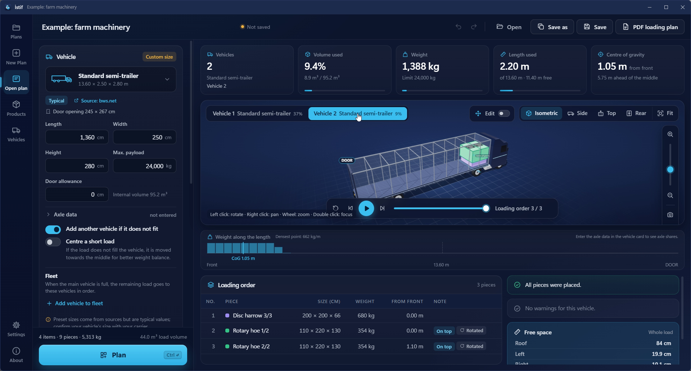

**Weight along the length**

The strip below the 3D area shows the load per metre as bars, assuming each piece's weight is spread evenly over the length it covers. Above it it says "Densest point: … kg/m"; point at a bar to see that slice's range and load. The centre of gravity (**CoG …**) and the middle of the vehicle are marked on the strip; if there is a door allowance, that zone is marked too. The left end says **Front**, the middle shows the vehicle length, and the right end says **DOOR**. If axle data was entered, the king pin and axle group are marked here as well.

**Axle share**

If the vehicle has axle data, the summary shows **King pin … · Axles …**: the load share on the king pin and on the axle group, in kg. The axle shares and the centre of gravity are **estimates**. They show only the share that comes from the load; the vehicle's own empty weight is not counted.

**Centre a short load**

While this switch is on and the load does not fill the vehicle, the whole load is moved towards the door for weight balance, without changing how the pieces sit relative to each other. The target is to bring the centre of gravity to the middle between the king pin and the axle group (or, with no axle data, to the middle of the usable length). The load is never pulled forward. If a shift was made, **Warnings** says "The load was moved back … m for weight balance; secure the rear with straps."

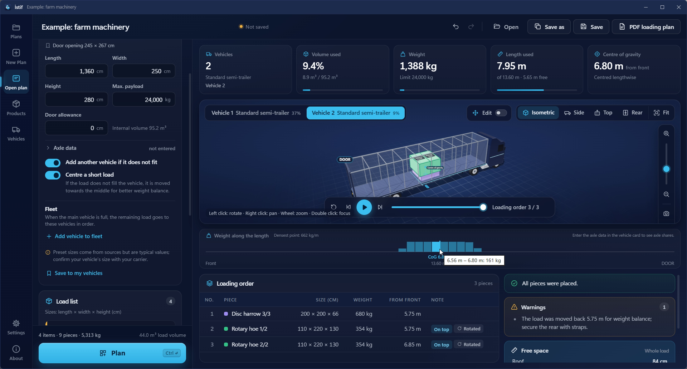

**Warnings**

The **Warnings** box lists warnings for the selected vehicle. If there are none, it says "No warnings for this vehicle." The main warnings are: the centre of gravity falling behind the axle group or ahead of the king pin, the load being unbalanced sideways, the weight limit being exceeded, and the load being moved back. If the calculation reaches its time limit, it says "The calculation reached its time limit; the result is still valid."

If an item does not fit the door opening of a vehicle with a known door opening, a separate **Door opening** box appears. It lists each item by name with a "vehicle: door opening size" line below it. In the load list the item gets a **Does not fit the door** label; pointing at it shows "Its two smallest sizes are larger than the vehicle’s door opening."

**Not loaded**

Pieces that could not be placed are listed under **Not loaded** with the reason:

| Reason | Meaning |
|---|---|
| does not fit the vehicle in any orientation | The piece is larger than the vehicle. |
| weight limit | The vehicle's weight limit is reached, or the piece on its own is heavier than the weight limit of every vehicle. |
| not allowed by the rules | Rules such as no stacking on top or floor only left no room. |
| piece limit reached or vehicle full | At most 300 pieces are placed in one calculation (after quantities are expanded). Also, pieces left over end up here when **Add another vehicle if it does not fit** is off or when the vehicles in the fleet run out. |

If everything is placed, it says "All pieces were placed."

If something did not fit, try: a larger vehicle, the **Add another vehicle if it does not fit** switch, adding vehicles to the fleet, a smaller door allowance, or a second look at the rules.

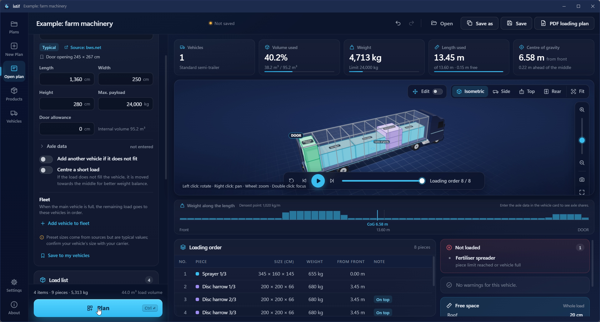

**Loading order table**

The table lists, for each piece, the order, name, size (cm), weight, distance from the front (m) and a note. Notes: **On top**, **Rotated**; when editing by hand also **Error** and **Warning**. Clicking a row selects the piece; double-clicking focuses the camera on it.

**Planning order**

İstif first tries to leave as few pieces unplaced as possible (and, if equal, the smallest volume). Then it aims for the fewest vehicles, then for the shortest total inside length of the vehicles used, then for the shortest used length in the last vehicle, then for a centre of gravity close to the middle. Unless the calculation hits the safety time limit, the same input always gives the same plan.

---

## 11. PDF loading plan

The PDF is for the warehouse staff and the driver. After planning, press the **PDF loading plan** button at the top right.

1. Plan first. If the plan has not been calculated, the button is dimmed and cannot be pressed.
2. Click **PDF loading plan**. The button says **Preparing PDF…**.
3. In the **Save as PDF** window, choose the place. The suggested file name is "plan name - loading plan".
4. After saving, a "PDF saved." message with a **Show in folder** link appears.

If the inputs changed after the last calculation, İstif warns you with a **Result out of date** window. If you choose **Create anyway**, the PDF is made with the last calculated placement.

**What is in the PDF** (A4 landscape, light background)

The first page is the summary:

- The plan name, "Loading plan" and the date and time. If the plan was edited by hand, **Edited by hand** is written too. If there are errors, an error note appears below this heading, before the summary boxes.
- Vehicle type, internal size and max. payload, vehicle count, pieces placed and total weight.
- The **Vehicles** table: for each vehicle the pieces, volume used, weight / limit, length used, centre of gravity and axle shares.
- The **Free space** table: for each vehicle the distance from the load to the roof, left, right, front and door.
- The **Warnings** and **Not loaded** boxes.
- The **Load list**: item, size, weight, quantity and rules.

The following pages have one page per vehicle: the vehicle heading, pieces, weight, volume used and length used, a free space line, three 3D images (isometric, top and side) and the **Loading order** table (number, piece, size, weight, distance from the front and note). Long tables are split across pages and the header row repeats on every page.

At the bottom of every page there is the note "Created with İstif … · Calculations are for planning; follow your carrier's rules for load securing and legal limits." and the page number.

If the 3D view could not open, "The 3D image could not be created." is written in place of the images.

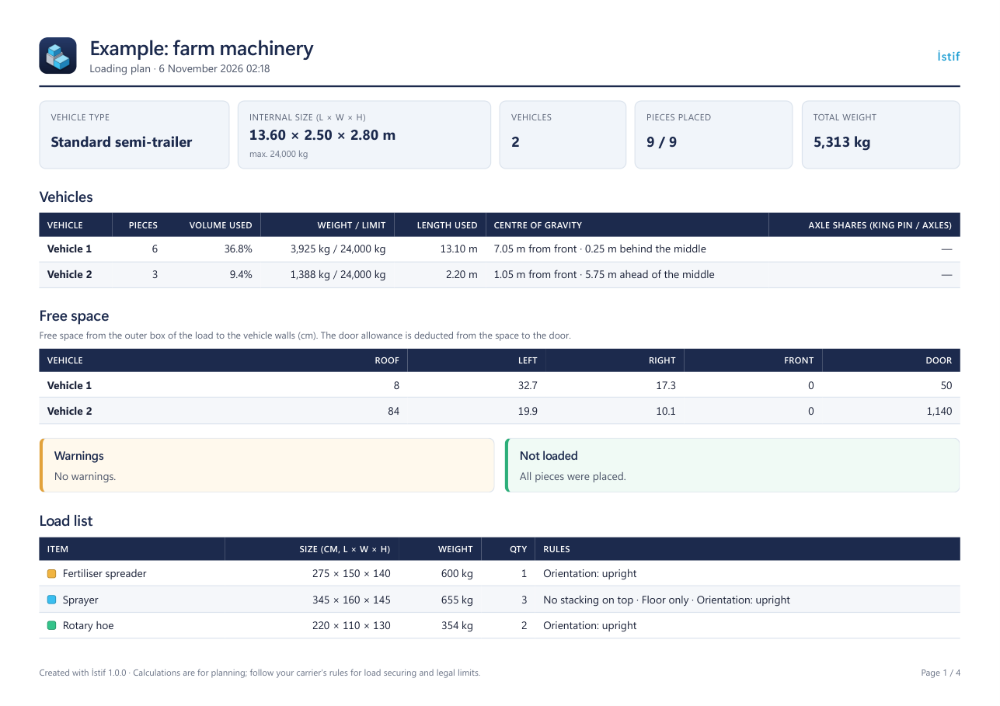

---

## 12. Importing a load from Excel

If you prepared your load list in Excel, you do not need to enter the items one by one.

**File types:** `.xlsx`, `.xls` and CSV. The file can be at most 20 MB. The file is read locally; it is not sent anywhere.

**Steps**

1. On the plan screen, click **Import from Excel**. The **Import load from Excel** window opens.
2. If you like, first save the ready-made template with **Download template** (`istif-load-template.xlsx`) and write your load in it.
3. Open your file with **Choose file…**. The first row must be the column headings. If the file has several sheets, you pick one from the **Sheet** list.
4. The **Match the columns** window opens. For each field, choose the column from your file. İstif guesses the matches from the headings; change them if they are wrong. Fields marked **required** cannot be left empty.
5. Check the **Length unit** (mm, cm, m or in) and the **Weight unit** (kg or lb). İstif guesses the units from the headings (for example "Length (cm)") or from the values; change them if they are wrong.
6. **Preview (first 10 rows)** shows rows. Columns: **Row**, **Name**, **Size**, **Weight**, **Qty**, **Rules**, **Status**. A good row says **OK**; a wrong row shows the reason (for example "Size missing or invalid", "Size too large; check the unit").
7. Click **Add (… items)**. Wrong rows are not added; the rest (all the valid rows in the file, not only the first 10) go into the list. If the required columns are not matched, the button stays dimmed and the window says "Required columns not matched: …".

**Columns**

| Field | Required? |
|---|---|
| **Name** | Yes |
| **Reference** | No |
| **Length** | Yes |
| **Width** | Yes |
| **Height** | Yes |
| **Weight** | No. If empty, 0 is used. It is the weight of one piece. |
| **Quantity** | No. If empty, 1 is used. |
| **No stacking on top**, **Floor only** | Rule column, optional |
| **Orientation** | Rule column, optional |
| **Top load limit** | Rule column, optional |
| **Delivery order** | Rule column, optional |

**What to write in rule columns**

- For yes: `yes`, `y`, `x`, `1`, `true`, `✓` (the Turkish words `evet`, `e`, `var`, `doğru` also work)
- For no: `no`, `n`, `0`, `false`, or leave it empty (the Turkish words `hayır`, `hayir`, `h`, `yok`, `yanlış` also work). A word İstif does not recognise also counts as no.
- For **Orientation**: `free` (or `any`), `upright` (or `vertical`), `fixed` (or `no rotation`); the Turkish words `serbest` (`her yön`), `dik` (`dikey`) and `sabit` (`döndürülmez`) also work. If you leave it empty or write a word that is not recognised, it becomes **Free**.
- If the program language is neither English nor Turkish, the words of that language are accepted too.

---

## 13. Saving and opening plans

Plans are saved as files with the `.istif` extension.

- **Save** (`Ctrl + S`): saves the plan. On the first save the **Save plan** window opens and you choose the place and name.
- **Save as** (`Ctrl + Shift + S`): saves the plan under a new name.
- **Open** or **Open plan…** (`Ctrl + O`): opens an `.istif` file with the **Open plan** window. Dragging the file onto the program window opens it too.
- **New Plan** (`Ctrl + N`): opens an empty plan.
- **Recent plans**: the **Plans** screen lists up to 10 plans you opened or saved last. Each card shows the plan name, vehicle, date, vehicle count, piece count, weight and fill. The folder icon on the card (**Show in folder**) opens the file's location. A plan whose file was deleted or moved is not listed. A plan you drag and drop onto the window is not added to this list.

If there are unsaved changes and you start a new plan or open another one, İstif asks with an **Unsaved changes** window: **Continue without saving**, or cancel. If you quit, a **Before you close** window appears: **Save and close**, **Close without saving** or **Cancel**.

**Opening by double-click.** If you installed with the installer, double-clicking an `.istif` file opens the plan in İstif. The portable version has no file association; open the plan with **Open** or drag the file onto the window.

**The file.** An `.istif` file is plain JSON text, at most 50 MB. The plan file stays with you; İstif does not send it anywhere. You can give it to a colleague by e-mail or in a shared folder. A layout edited by hand is saved in the file too (section 9).

**Undo and redo.** Changes to the plan inputs (vehicle, items, options) and to manual edits can be undone: the icons in the top bar, or `Ctrl + Z` / `Ctrl + Y`. The history keeps at most 100 steps. Typing in one field counts as one step. While you are in a text field, `Ctrl + Z` is the field's own undo.

**Automatic draft.** While there are unsaved changes, İstif writes a draft every 30 seconds. On a normal exit the draft is deleted. After a power cut or a crash, the next start shows an **Unsaved plan** window: "The program closed unexpectedly and an unsaved plan was found. Restore it?" You choose **Restore** or **Discard**.

**Where is your data?**

- `%APPDATA%\Istif\`: your product and vehicle library (`kutuphane.json`), recent plans (`son-planlar.json`), settings (`ayarlar.json`) and the automatic draft (`taslak.json`). **Settings** > **Data** > **Open data folder** opens this folder.
- `%LOCALAPPDATA%\Istif\`: the WebView2 cache and the error log (`gunluk.txt`).

When you uninstall İstif, these folders are not deleted; your user data stays where it is.

---

## 14. Language, theme and settings

The **Settings** screen in the side rail has these sections: **Appearance** (**Language**, **Theme**, **Animations**, **Units**), **Planning** (**Default vehicle**), **Updates** and **Data**. The settings are stored on this computer.

**Language.** İstif is available in 12 languages: Turkish, English, German, French, Spanish, Italian, Portuguese, Russian, Arabic, Chinese, Japanese and Korean. The first option in the language list is **System language (…)** and it is the default: it follows the display language of Windows. If the Windows language is not among the supported languages, İstif opens in English. When you change the language you do not need to close and reopen the program: the interface reloads and your open plan is kept. If a language is missing a text, that text is shown in English. In Arabic the interface is drawn right to left.

**Theme.** **System**, **Dark** or **Light**. **System** follows the light or dark app setting of Windows. The theme is applied immediately.

**Animations.** **On** (default): pieces drop into place, and slide and turn while editing. **System**: follows the Windows animation effects setting. **Off**: no animations. Applied immediately.

**Units.** **Metric (cm, kg)** or **Imperial (in, lb)**. Sizes and weights are entered and shown in these units (including in the PDF and in the Excel import). The calculation always uses millimetres and kilograms. When you change the unit, the interface reloads too and the open plan is kept.

**Default vehicle.** New plans start with this vehicle.

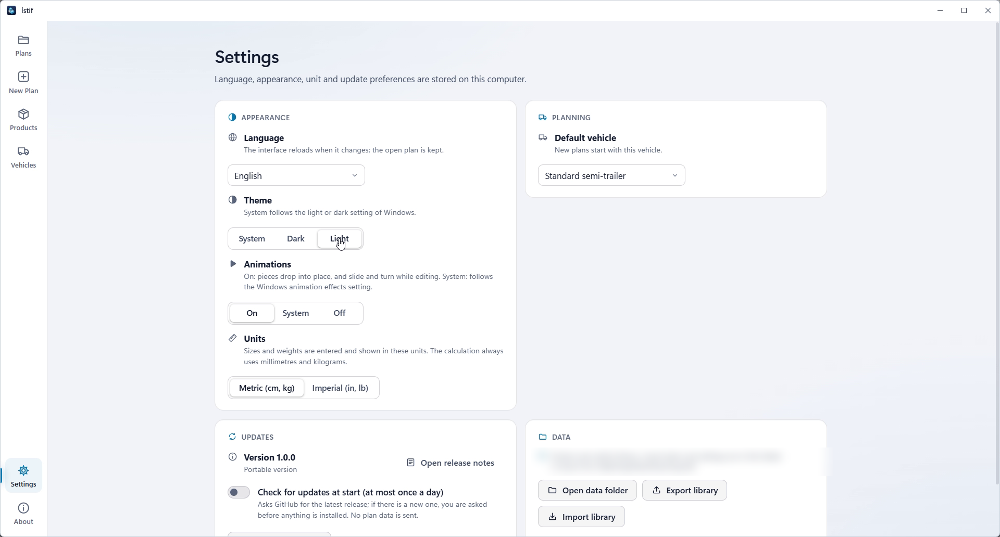

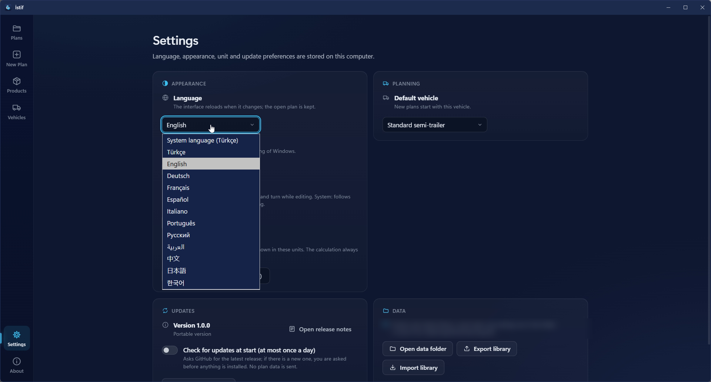

---

## 15. Updates

İstif goes online only to check for updates. Plan and load data are not sent.

- On start, if the **Check for updates at start (at most once a day)** switch is on and 24 hours have passed since the last check, İstif asks GitHub for the latest version. The switch is on by default.
- If there is a new version, a **New version: …** window opens. Under "In this version" it lists what changed, in the program's language (or in English if there are no notes in that language, and otherwise the release description on GitHub). You choose **Update** or **Later**. Nothing is downloaded or installed until you agree.
- When you press **Update**, if the open plan has unsaved changes, İstif asks "Do you want to save the open plan before updating?"
- While downloading it says **Downloading …%**. The downloaded file is checked against the SHA-256 checksum in `SHA256SUMS.txt`, published with the release. If the checksum does not match, the file is deleted and not installed. If the release has no `SHA256SUMS.txt`, or the file is not in the list, it is not installed either.
- If you installed with the installer, the new installer is downloaded and runs silently; after the installation the program opens again. In the portable version the new `Istif.exe` is downloaded; the program closes, the file is overwritten and the program opens again. Which one you use is written under **Settings** > **Updates**: **Installed with the setup package** or **Portable version**.
- If something goes wrong, it says **The update failed.** and gives the reason.

**To check by hand:** in the **Updates** section of **Settings**, click **Check for updates**. If there is no new version, "No new version found." appears next to it. The **Update settings** button on the **About** screen takes you to the **Settings** screen.

**To turn it off:** in the **Updates** section of **Settings**, turn off the **Check for updates at start (at most once a day)** switch. If you start with `Istif.exe --cevrimdisi`, it does not check at start in that session; the **Check for updates** button still works.

**Release notes:** the **Open release notes** button (on the **Settings** and **About** screens) shows what changed in this and earlier versions.

---

## 16. Shortcuts

**General**

| Shortcut | Action |
|---|---|
| `Ctrl + N` | New plan |
| `Ctrl + O` | Open plan |
| `Ctrl + S` | Save plan |
| `Ctrl + Shift + S` | Save as |
| `Ctrl + Enter` | Plan (on the plan screen) |
| `Ctrl + Z` | Undo (on the plan screen) |
| `Ctrl + Y` | Redo (on the plan screen; `Ctrl + Shift + Z` also works) |
| `Space` | Play / pause (while the 3D area is selected and editing is off) |
| `+` and `−` | Zoom in / out (while the 3D area is selected) |

**Mouse in the 3D area:** left click rotates, right click pans, the wheel zooms, a double click focuses.

**While editing by hand**

| Shortcut | Action |
|---|---|
| Drag | Move |
| `Alt` + drag | Lift (move up and down) |
| `Shift` + drag | Select area |
| `Ctrl` + click | Add to / remove from the selection |
| Arrow keys | Nudge by one grid step (ten steps with `Shift`) |
| `Page Up` / `Page Down` | Move up / down |
| `R` / `T` / `Y` | Turn flat / tip onto its side / tip forward |
| `Esc` | Clear the selection (cancels the drag while dragging) |

**In lists:** in the fleet list, `Alt + ↑/↓` changes the order and `Delete` removes a vehicle. In the load list, `Enter` edits an item and `Delete` deletes it. In the side rail, `↑/↓` moves between items.

Some of these shortcuts are also listed on the **About** screen.

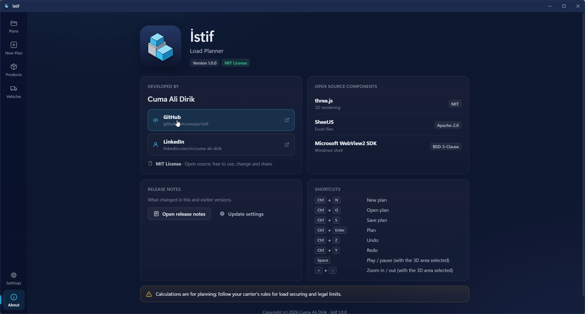

---

## 17. FAQ

**Is İstif free?**
Yes. It is open source under the MIT license. The source code is [on GitHub](https://github.com/ceceys/istif).

**Which Windows versions does it run on?**
64-bit Windows 10 (version 1809 and newer) and Windows 11. It also needs the .NET 8 Desktop Runtime and the WebView2 Runtime (section 1).

**Is my data sent anywhere?**
No. Plan and load data are never sent. The program goes online only to check for updates. İstif does not open the source links in the vehicle catalogue by itself; they open in your default browser only when you click them.

**Does it work offline?**
Yes. Planning, the 3D view, the PDF and Excel reading do not need the internet. If the update check cannot run, the program still opens. If you start it with `Istif.exe --cevrimdisi`, it does not check at start.

**If I plan the same load twice, do I get the same result?**
Yes. Unless the calculation hits the safety time limit, the same input always gives the same plan.

**Do I have to enter the vehicle size myself?**
You can choose a preset type or a vehicle from the catalogue, or enter the size yourself. Preset sizes are typical values; confirm the real size with your carrier.

**Why did a piece not fit?**
The **Not loaded** box gives the reason (section 10).

**I changed the plan but the result stayed the same.**
When the inputs change, the result becomes out of date and a warning appears above the 3D area. Press **Plan** again. On a plan edited by hand, planning again discards your manual changes; İstif asks first.

**Why is there no axle share?**
The vehicle has no axle data. See section 4.

**Are the axle share and the centre of gravity exact?**
No, they are estimates.

**Which files can it open?**
`.istif` plan files, and Excel (`.xlsx`, `.xls`) and CSV load lists. For library import, `.json`.

**The 3D view does not open.**
If İstif cannot start the 3D view, it says "The 3D view could not start on this computer. Results are shown in the table." The results still appear in the tables. In the PDF, "The 3D image could not be created." is written in place of the 3D images.

**What should I do if I find a bug?**
[Open an issue on GitHub](https://github.com/ceceys/istif/issues/new/choose). Include in your report: the İstif version (shown on the **About** screen), your Windows version, the vehicle and the load that cause the problem (if you can share them), and the last lines of `%LOCALAPPDATA%\Istif\gunluk.txt`. The log file holds error messages and may contain file paths; remove anything private. Do not attach plans or screenshots that contain confidential customer data. Report security problems [privately](https://github.com/ceceys/istif/security/advisories/new) instead of in a public issue.

**Can I suggest a new language or a translation fix?**
Yes. Open an issue or see [CONTRIBUTING.md](../../CONTRIBUTING.md) in the repository.

---

## 18. Limits and responsibility note

- Calculations are for planning; for load safety and legal limits, follow your carrier's rules. This note is also on the **About** screen and at the bottom of every PDF.
- İstif does not check load securing, dangerous goods rules or road permits. The program has no input fields for them either. The only related text is the "secure the rear with straps" warning that appears when the load is moved back for weight balance.
- The centre of gravity and the axle share are estimates.
- Preset vehicle sizes come from sources but are typical values; confirm your vehicle's size with your carrier.
- The program is provided "as is". The terms of the MIT license are in the [LICENSE](../../LICENSE) file.
