# İstif kullanım rehberi

İstif, tır, kamyon ve konteynere yüklenecek makine, kasa ve kolileri 3B yerleştiren, Windows için ücretsiz ve açık kaynak bir yükleme planlayıcısıdır. Bu rehber kurulumdan PDF çıktısına kadar her adımı anlatır.

English: [en.md](en.md)

## İçindekiler

1. [Kurulum ve ilk açılış](#1-kurulum-ve-ilk-açılış)
2. [Arayüzü tanıyın](#2-arayüzü-tanıyın)
3. [Hızlı başlangıç: ilk planınız](#3-hızlı-başlangıç-ilk-planınız)
4. [Araç seçmek ve özel ölçü](#4-araç-seçmek-ve-özel-ölçü)
5. [Karışık filo](#5-karışık-filo)
6. [Yük listesi ve kurallar](#6-yük-listesi-ve-kurallar)
7. [Ürün ve araç kütüphanesi](#7-ürün-ve-araç-kütüphanesi)
8. [3B görünüm](#8-3b-görünüm)
9. [Elle düzenleme](#9-elle-düzenleme)
10. [Sonucu okumak](#10-sonucu-okumak)
11. [PDF yükleme planı](#11-pdf-yükleme-planı)
12. [Excel'den yük almak](#12-excelden-yük-almak)
13. [Plan kaydetme ve açma](#13-plan-kaydetme-ve-açma)
14. [Dil, tema ve ayarlar](#14-dil-tema-ve-ayarlar)
15. [Güncellemeler](#15-güncellemeler)
16. [Kısayollar](#16-kısayollar)
17. [Sık sorulanlar](#17-sık-sorulanlar)
18. [Sınırlar ve sorumluluk notu](#18-sınırlar-ve-sorumluluk-notu)

---

## 1. Kurulum ve ilk açılış

**Gereksinimler**

- Windows 10 (sürüm 1809 ya da daha yeni) veya Windows 11. Yalnız 64 bit Windows desteklenir.
- .NET 8 Desktop Runtime (x64).
- Microsoft Edge WebView2 Runtime. Windows 11'de hazır gelir.

**Kurulum paketiyle**

1. [Istif-Setup.exe](https://github.com/ceceys/istif/releases/latest/download/Istif-Setup.exe) dosyasını indirin.
2. Çalıştırın ve adımları izleyin.
3. İstif'i Başlat menüsünden açın.

Kurulum hakkında bilmeniz gerekenler:

- Kurulum varsayılan olarak yalnız sizin kullanıcı hesabınız için yapılır ve yönetici hakkı istemez. Kurulumun başında "tüm kullanıcılar için" kurma seçeneğini sunan bir pencere çıkabilir. Bu seçeneği seçerseniz Windows yönetici izni isteyebilir.
- Kurulum paketi .NET'i içermez. Kurulum başında .NET 8 Desktop Runtime ve WebView2 Runtime denetlenir. Biri eksikse kurulum durur ve Microsoft'un indirme sayfasını tarayıcıda açmayı önerir. Kurulumun kendisi hiçbir şey indirmez. Sayfadan ".NET Desktop Runtime 8" (x64) ya da WebView2 için "Evergreen Bootstrapper" ya da "Evergreen Standalone Installer" dosyasını indirip kurun, sonra İstif kurulumunu yeniden başlatın.
- Başlat menüsüne kısayol eklenir. Masaüstü kısayolu isteğe bağlıdır.
- `.istif` uzantısı İstif'e bağlanır. Bir plan dosyasına çift tıklayınca plan İstif'te açılır (bölüm 13).
- Kaldırdığınızda planlarınız, kütüphaneniz ve ayarlarınız yerinde kalır (bölüm 13).

**Windows SmartScreen uyarısı**

İstif dosyaları kod imzalı değildir. Bu yüzden Windows SmartScreen bir uyarı penceresi gösterebilir. Bu beklenen bir durumdur. Devam etmek için penceredeki ek bilgi bağlantısına, ardından çıkan çalıştırma düğmesine tıklayın. Dosyayı yalnız projenin [GitHub sürümler sayfasından](https://github.com/ceceys/istif/releases/latest) indirin. Aynı sayfada `SHA256SUMS.txt` dosyası da bulunur; indirdiğiniz dosyanın SHA-256 özetini oradakiyle karşılaştırabilirsiniz.

**Taşınabilir sürümle**

1. [Istif.exe](https://github.com/ceceys/istif/releases/latest/download/Istif.exe) dosyasını indirin. Kurulumsuz, tek dosyadır.
2. .NET 8 Desktop Runtime ve WebView2 Runtime kurulu olmalı. Taşınabilir sürüm de bunları ister.
3. Dosyayı istediğiniz klasörden çalıştırın.

Taşınabilir sürüm Başlat menüsü kısayolu eklemez ve `.istif` uzantısını İstif'e bağlamaz; bunlar kurulum paketiyle gelir. Planlarınız ve ayarlarınız yine aynı yerde saklanır.

WebView2 eksikse program açılırken "Programın çalışması için Microsoft Edge WebView2 Çalışma Zamanı gerekir" iletisi çıkar. Windows 10'da Microsoft'un sitesinden "WebView2 Runtime" kurup programı yeniden açın.

**İlk açılış**

Açılışta kısa bir açılış ekranı görünür, ardından **Planlar** ekranı gelir. İlk açılışta dil, Windows'un görüntü diline göre seçilir. Windows dili İstif'in 12 dilinden biri değilse İngilizce açılır (bölüm 14).

**Planlar** ekranında üstte **Hoş geldiniz** başlığı ile **Yeni yükleme planı** ve **Plan aç…** düğmeleri durur. Altında **Örnek yükler** bölümü vardır: dört örnek kart. Onun altında **Son planlar** listesi gelir. Henüz plan kaydetmediyseniz bu bölümde **Henüz kayıtlı plan yok** yazar ve üç adım gösterilir: **Aracı seçin**, **Yükü girin**, **Planlayın**. Açık planınızda kalem varsa ya da plan bir dosyadan açıldıysa **Açık plan** kartı ve **Plana dön** düğmesi de görünür.

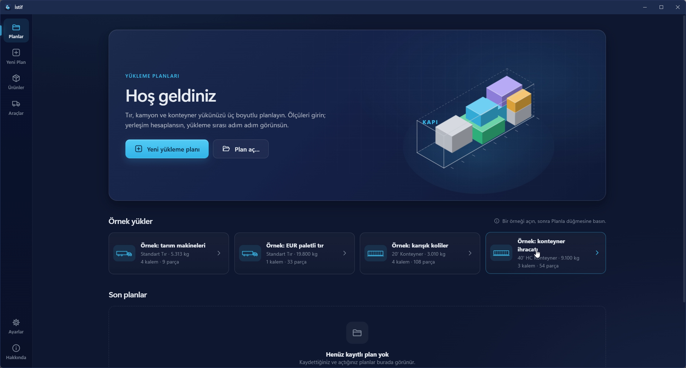

---

## 2. Arayüzü tanıyın

**Sol şerit.** Ekranın solunda dikey bir şerit vardır. Üstte **Planlar**, **Yeni Plan**, **Açık plan**, **Ürünler** ve **Araçlar** durur. **Açık plan** yalnız bir plan açıkken görünür. En altta **Ayarlar** ve **Hakkında** vardır. Dil, tema ve birim **Ayarlar** ekranından değiştirilir (bölüm 14); plan ekranında bunlar için ayrı düğme yoktur.

**Plan ekranı** (**Açık plan**) şu parçalardan oluşur:

- **Üst çubuk.** Solda planın adı (üstüne tıklayıp değiştirebilirsiniz) ve yanında **Kaydedilmedi** ya da **Kaydedildi** durumu. Plan elle düzenlendiyse **Elle düzenlendi** etiketi, hata varsa **Planda … hata var** etiketi de burada görünür. Sağda geri al ve yinele simgeleri ile **Aç**, **Farklı kaydet**, **Kaydet** ve **PDF yükleme planı** düğmeleri durur. **PDF yükleme planı** düğmesi plan hesaplanana kadar soluk kalır.
- **Sol sütun.** Üstte **Araç** kartı (araç seçici, ölçü alanları, **Aks bilgisi**, iki anahtar, **Filo**). Onun altında **Yük listesi** kartı (**Kalem ekle**, **Ürünlerden ekle**, **Excel'den al**). Sütunun en altında sabit bir şerit vardır: kalem sayısı, parça sayısı ve toplam ağırlık ile büyük **Planla** düğmesi.
- **Özet kartları.** Sağ tarafın en üstünde beş kart: **Araç sayısı**, **Hacim doluluğu**, **Ağırlık**, **Kullanılan uzunluk**, **Ağırlık merkezi**. Plan hesaplanmadan önce bu kartlar boştur (—).
- **3B alan.** Özet kartlarının altında. Üstünde araç sekmeleri (birden çok araç varsa), **Düzenle** anahtarı ve görünüm düğmeleri bulunur. Sağ kenarda yakınlaştırma düğmeleri ve çubuğu, kamera (PNG kaydet) ve tam ekran düğmeleri durur. Altında oynatma çubuğu vardır.
- **Uzunluk boyunca ağırlık** şeridi, 3B alanın altında.
- **Yükleme sırası** tablosu, sol altta. Sağında uyarı sütunu: **Sığmayanlar**, **Uyarılar** ve **Kalan boşluk**.

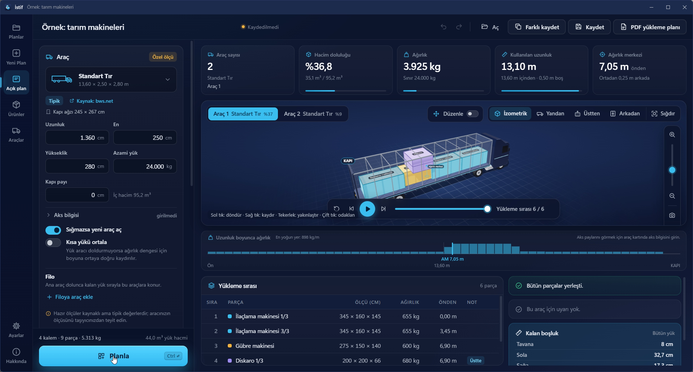

---

## 3. Hızlı başlangıç: ilk planınız

En kolay başlangıç hazır örnektir.

1. **Planlar** ekranında **Örnek yükler** altından **Örnek: tarım makineleri** kartına tıklayın. Plan açılır. İçinde gübre makinesi, ilaçlama makinesi, çapa makinesi ve diskaro vardır (4 kalem, 9 parça).
2. Örneği açmak planlamaz. 3B alanda "Yükleri ekleyin, sonra Planla düğmesine basın." yazar.
3. Soldaki **Araç** kartına bakın: seçili aracı ve ölçülerini görürsünüz.
4. **Yük listesi**'ne bakın. Her kalemin ölçüsü, ağırlığı, adedi ve kuralları yazar.
5. **Planla**'ya basın (kısayol: `Ctrl + Enter`). Hesap sürerken düğmede **Hesaplanıyor** yazar. Bitince yerleşim 3B alanda görünür. Bu örnek tek tıra sığmaz; **Sığmazsa yeni araç aç** anahtarı açık olduğu için İstif ikinci bir araç açar ve 3B alanın üstünde **Araç 1** ile **Araç 2** sekmeleri çıkar.
6. **Oynat**'a basın. Parçalar yükleme sırasıyla yerine iner.
7. Bir parçanın üzerine gelin: **Ölçü**, **Ağırlık**, **Sıra** ve **Konum** bilgisi görünür.
8. Üstteki özet kartlarından araç sayısını, hacim doluluğunu ve ağırlık merkezini okuyun.

Kendi planınız için:

1. Sol şeritten **Yeni Plan**'ı seçin. Plan, **Ayarlar**'daki varsayılan araçla açılır; ayarı değiştirmediyseniz bu Standart Tır'dır.
2. Aracı seçin ya da ölçüsünü girin (bölüm 4).
3. Yük kalemlerini ekleyin (bölüm 6).
4. **Planla**'ya basın.

Planlamak için en az bir yük kalemi gerekir. Aracın ve filodaki araçların uzunluk, en ve yükseklik değerleri ile her kalemin ölçüleri de girilmiş olmalıdır. Eksik varsa İstif bunu yazar. Örneğin: "Planlamak için en az bir yük kalemi ekleyin."

Yük ya da araç değişirse sonuç eski kalır. 3B alanın üstünde "Girdiler değişti. Güncel sonuç için yeniden planlayın." etiketi çıkar. **Planla**'ya yeniden basın.

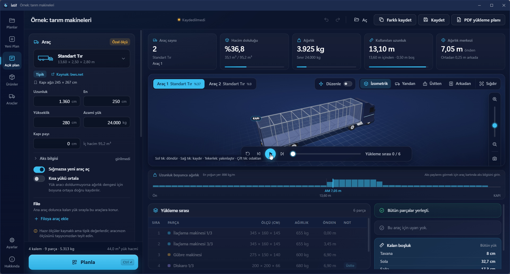

---

## 4. Araç seçmek ve özel ölçü

**Hazır tipler**

**Araç** kartının üstündeki araç seçiciye tıklayın. Açılan listede **Hazır tipler** grubu şunları içerir: Standart Tır, Mega Tır, 20' Konteyner, 40' Konteyner, 40' HC Konteyner ve Panelvan (Ford Transit L3H2). Kendi kaydettiğiniz araçlar **Araçlarım** grubunda durur. Listenin sonunda **Gelişmiş katalog…** vardır (bölüm 7).

Seçili tipin altında şu bilgiler görünür:

- **Tipik** ya da **Model föyü** etiketi. **Tipik**: bir standarttan ya da birden çok kaynağın ortak değerinden gelir, üreticiye göre birkaç cm oynayabilir. **Model föyü**: belirli bir üretici modelinin föyünden alınmıştır.
- **Kaynak** bağlantısı. Tıklayınca varsayılan tarayıcınızda açılır.
- **Kapı ağzı** ölçüsü (en × yükseklik).
- Panelvanda "Genişlik tekerlek davlumbazları arasıdır." notu.

Hazır ölçüler kaynaklıdır ama tipik değerlerdir. Aracınızın gerçek iç ölçüsünü taşıyıcınızdan öğrenin.

**Özel ölçü**

İstif'te araç ölçüsü serbestçe girilir. **Araç** kartındaki alanları doldurun:

| Alan | Ne demek |
|---|---|
| **Uzunluk** | Kasanın iç uzunluğu |
| **En** | İç genişlik |
| **Yükseklik** | İç yükseklik |
| **Azami yük** | Araca yüklenebilecek en fazla ağırlık. 0 girerseniz ya da boş bırakırsanız ağırlık sınırı uygulanmaz. |
| **Kapı payı** | Arka kapı tarafında boş bırakılacak pay |

Alanlar **Ayarlar**'daki birim sistemiyle çalışır: metrikte cm ve kg, imperial'de in ve lb (bölüm 14). Ölçüleri seçili tipten farklı girerseniz kartın üstünde **Özel ölçü** etiketi çıkar. Ölçüyü girince **İç hacim** yanda yazılır.

Bazı katalog kayıtlarında yük kapasitesi kaynakta yoktur. O zaman **Azami yük** alanı boş kalır ve "Yük kapasitesi kaynakta yok; aracınızın değerini girin." uyarısı görünür.

**Kapı payı**

Arka kapı tarafında boş kalması gereken mesafeyi **Kapı payı** alanına yazın. İstif bu bölgeye parça koymaz. Kapı payı olan bir araçta 3B alanın altındaki ağırlık şeridinde bu bölge ayrıca işaretlenir (bölüm 10).

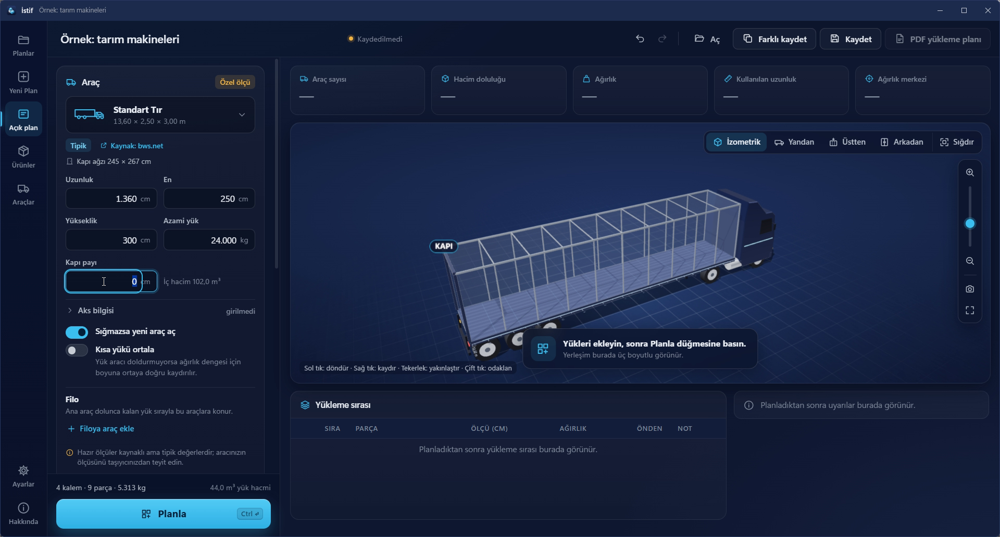

**Aks bilgisi (isteğe bağlı)**

**Araç** kartında **Aks bilgisi** satırına tıklayınca iki alan açılır. Aynı alanlar **Araçlar** ekranında bir aracı düzenlerken de bulunur.

- **Şasi kilidi (king pin)**: ön duvardan ölçülür.
- **Aks grubu ortası**: ön duvardan ölçülür. Şasi kilidinin gerisinde olmalıdır.

İki değeri de girerseniz İstif şasiye ve aks grubuna düşen yük payını tahmin eder (kg olarak). Aks bilgisi girilmezse aks payı gösterilmez; satırda **girilmedi** yazar. Hazır tiplerde aks bilgisi yoktur, kendiniz girersiniz. İki değerden biri eksikse, aks grubu şasi kilidinden ileride ya da onunla aynı yerdeyse veya araç boyunu 5 m'den fazla aşıyorsa "Aks bilgisinde iki değer de girilmeli ve aks şasiden geride olmalı." uyarısı çıkar.

**Kendi aracınızı saklamak**

Girdiğiniz ölçüyü kartın altındaki **Araçlarıma kaydet** ile kaydederseniz sonraki planlarda araç seçicideki **Araçlarım** grubundan seçersiniz (bölüm 7).

---

## 5. Karışık filo

Bir araç dolunca kalan yük için aynı tipte ikinci araç yerine daha küçük bir araç yetebilir. İstif bunu **Filo** ile yapar.

**Önce iki anahtar**

**Araç** kartında iki anahtar vardır:

- **Sığmazsa yeni araç aç**: Yük tek araca sığmazsa İstif yeni araç açar. Anahtar açıkken (yeni planlarda varsayılan) araçlar gerektiği kadar çoğalır. Kapalıyken yalnız seçtiğiniz araçlar kullanılır; sığmayan parçalar **Sığmayanlar** listesine düşer (bölüm 10).
- **Kısa yükü ortala**: Yük aracı doldurmuyorsa ağırlık dengesi için yük boyuna ortaya doğru kaydırılır. Bölüm 10'da anlatılır.

**Filo nasıl kurulur**

1. **Araç** kartında **Filo** bölümüne gelin. Açıklaması: "Ana araç dolunca kalan yük sırayla bu araçlara konur."
2. **Filoya araç ekle**'ye tıklayın. Açılan pencerede hazır tiplerden, **Araçlarım**'dan ya da **Gelişmiş katalog…**'dan bir araç seçin.
3. Liste kurulur: 1 numaralı satır **Ana araç**tır. Eklediğiniz araçlar 2, 3… diye sıralanır. Ana araca ek olarak en çok 8 araç eklenebilir; sınıra gelince düğme kaybolur.
4. Sırayı değiştirmek için satırı sürükleyin, satırdaki yukarı ve aşağı oklarını kullanın ya da satırdayken `Alt + ↑/↓` tuşlarına basın. Çarpı düğmesi (ya da `Delete`) aracı listeden çıkarır.
5. **Planla**'ya basın.

**Araçlar nasıl kullanılır**

- Araçlar listedeki sırayla kullanılır. **Sığmazsa yeni araç aç** açıksa listenin son tipi gerektikçe yinelenir. Kapalıysa listedeki her araç bir kez kullanılır.
- Bir parça sıradaki araca ölçü ya da tonaj yüzünden hiç sığmıyorsa o araç atlanır, parça sıradaki uygun araca konur.
- Hiç parça almayan araç sonuçta görünmez.
- Filoda en az bir araç varken **Kalan yük için en uygun aracı seç** anahtarı çıkar. Açıkken ilk araç yine listenin ilk tipidir. Kalan yük için listedeki her tip denenir; kalan yükü en az araçla, araç sayısı eşitse en kısa toplam boyla alan tip seçilir. **Sığmazsa yeni araç aç** açıksa seçilen tip gerektikçe yinelenir. Kapalıysa ikinci araç olarak her tip ayrı denenir; kalan araçlar listedeki sırayla birer kez kullanılır.

**Sonuç**

Sonuçta her araç ayrı sekmede görünür. Sekmede aracın tipi ve doluluk yüzdesi yazar (bölüm 10). Özet kartlarındaki **Araç sayısı** altında tip adını gösterir. PDF'te her aracın adı (tipler farklıysa) ve kendi ağırlık sınırı ayrı yazar (bölüm 11).

**Ne zaman işe yarar**

Örnek: yükün büyük kısmı bir tıra sığıyor, geriye birkaç koli kalıyor. Bu koliler için ikinci bir tır yerine daha küçük bir araç yeterli olabilir.

---

## 6. Yük listesi ve kurallar

**Kalem eklemek**

1. **Yük listesi** kartında **Kalem ekle**'ye tıklayın. **Yük kalemi ekle** penceresi açılır.
2. Şu alanları doldurun:
   - **Ad** (ör. Gübre makinesi)
   - **Referans** (isteğe bağlı)
   - **Ölçüler**: **Uzunluk**, **En**, **Yükseklik**
   - **Ağırlık (tek parça)**
   - **Adet**
   - **Renk**: on hazır renkten biri ya da kendi seçtiğiniz renk. Parçaları 3B alanda ayırt etmeye yarar.
   - **Yön**: **Serbest**, **Dik** ya da **Sabit**
   - **Kurallar**: aşağıda anlatılıyor
3. **Kaydet**'e tıklayın. Kalem listeye eklenir. **Vazgeç** pencereyi kapatır.

Eksik ya da hatalı alanlar pencerede işaretlenir: "Ad girin.", "Uzunluk, en ve yükseklik sıfırdan büyük olmalı.", "Adet en az 1 olmalı." gibi.

Planlanmış bir plana kalem eklerseniz ya da kalemi değiştirirseniz sonuç eskir; yeniden **Planla**'ya basın.

Sol sütunun altındaki şeritte kalem sayısı, parça sayısı ve toplam ağırlık ile yük hacmi yazar. Listede her kalemde ad, adet, ölçü, ağırlık ve kural etiketleri görünür. Araç kapı ağzı biliniyorsa ve kalemin en küçük iki ölçüsü kapı ağzından büyükse kalemde kırmızı **Kapıdan geçmez** etiketi çıkar.

Bir kalemi düzenlemek için satıra tıklayın (ya da `Enter`) ya da satırdaki **Düzenle** simgesini kullanın. Silmek için **Sil** simgesine (ya da `Delete`) tıklayın. Silince **Geri al** seçeneği birkaç saniye görünür.

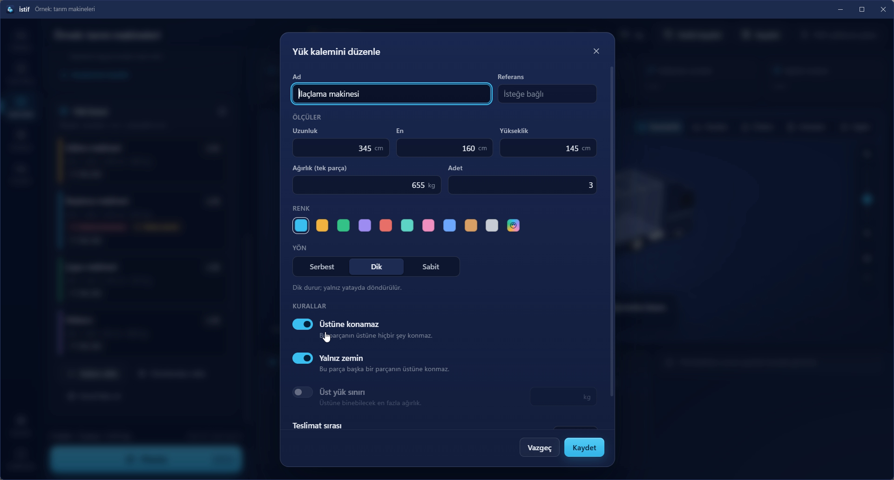

### Kurallar: ne zaman hangisi?

**Üstüne konamaz**

Bu parçanın üstüne hiçbir şey konmaz. Kırılgan ya da üstüne yük binmemesi gereken parçalarda kullanın.

Örnek: ilaçlama makineleri üst üste konamıyor. İlaçlama makinesi kalemini **Üstüne konamaz** yapın. Hiçbir parça onun üstüne çıkmaz, böylece ilaçlama makineleri üst üste binmez. Bu kural açıkken **Üst yük sınırı** anlamsız olduğu için kapalı gelir.

**Yalnız zemin**

Bu parça başka bir parçanın üstüne konmaz; yalnız araç zeminine oturur. Ağır ya da tabanı dar parçalarda kullanın.

Örnek: **Yalnız zemin** verdiğiniz bir diskaro kasanın üstüne çıkmaz.

**Üst yük sınırı**

Bu parçanın üstüne binebilecek en fazla ağırlık (kg). Üstüne yük konabilsin ama sınırlı olsun istediğinizde kullanın. Sınır, parçanın üstünde doğrudan ya da dolaylı duran bütün parçaların toplam ağırlığına uygulanır.

Örnek (değerler örnektir): bir kasanın üst yük sınırı 100 kg ise, üstüne 150 kg'lık bir parça konmaz; 80 kg'lık konabilir.

**Yön**

| Yön | Anlamı | Ne zaman |
|---|---|---|
| **Serbest** | Her yöne döndürülebilir. | Koli ve düz kasalar. |
| **Dik** | Dik durur; yalnız yatayda döndürülür. | "Bu taraf yukarı" yazan, devrilmemesi gereken parçalar. |
| **Sabit** | Hiç döndürülmez; girildiği gibi yüklenir. | Yönü değişmemesi gereken makineler. |

Yön kuralı elle düzenlerken de geçerlidir (bölüm 9).

**Teslimat sırası**

Çok duraklı sevkiyatta büyük numara önce yüklenir (en öne gider). Tek durakta 0 bırakın. 0'dan büyük numaralar listede **Durak …** etiketiyle görünür. Elle düzenlerken sonra indirilecek bir parçayı önce indirilecek parçanın önüne koyarsanız sarı bir **Teslimat sırası** uyarısı çıkar (bölüm 9).

---

## 7. Ürün ve araç kütüphanesi

**Ürünler**

Sık yüklediğiniz ürünleri ölçü ve kurallarıyla saklayın. Kütüphanede başlangıçta örnek ürünler vardır: gübre makinesi, ilaçlama makinesi, çapa makinesi, diskaro, EUR palet (120 × 80) ve endüstriyel palet (120 × 100). Palet ürünlerinin yükseklik ve ağırlık değerleri başlangıç değeridir; kendi yükünüze göre düzeltin.

1. Sol şeritten **Ürünler**'e gidin.
2. **Yeni ürün**'e tıklayın ve alanları doldurun. Ürün penceresinde **Adet** ve **Teslimat sırası** yoktur; bunlar plandaki kaleme özgüdür.
3. Plan ekranında **Ürünlerden ekle**'yi seçin, ürünü bulun (**Ürün ara**), adedi ayarlayın ve **Ekle**'ye tıklayın. Pencere açık kalır; birden çok ürün ekleyip **Tamam**'a basabilirsiniz.

**Ürünler** ekranında bir ürünün **Plana ekle** düğmesi ürünü açık plana bir adet olarak ekler. Ürün satırına tıklayınca düzenleme açılır. Silince onay sorulur; ürün kütüphanesinden sildiğiniz ürün, planlardaki kalemleri etkilemez. Yük kalemi eklerken **Ürün kütüphanesine de kaydet**'i açarsanız ürün kütüphaneye de girer.

**Araçlar**

**Araçlar** ekranında iki sekme vardır: **Araçlar** ve **Gelişmiş**.

**Araçlar** sekmesinde iki grup durur: **Araçlarım** ve **Hazır tipler**.

- Hazır tipler silinemez. **Kopyala** ile kopyalayıp kendi ölçünüzle kaydedebilirsiniz.
- **Yeni araç** ile sıfırdan araç eklersiniz: ad, tür, iç ölçü, azami yük, kapı payı ve isteğe bağlı aks bilgisi. Yeni araç Standart Tır'ın ölçüleriyle başlar.
- **Planda kullan** aracı açık plana alır. Açık plan yoksa yeni plan açılır.
- **Tür** (Tır, Kamyon, Kamyonet, Konteyner) 3B görünümdeki araç modelini belirler.
- Araçlarım'daki araçlar düzenlenebilir ve silinebilir.

**Gelişmiş** sekmesi araç kataloğunun tamamıdır (sekmede kayıt sayısı yazar). Arama kutusu ile **Kategori** ve **Üretici** süzgeçleri vardır. Katalogdaki kategoriler: Konteyner, Dorse, Panelvan ve Demiryolu (kategori listesinde yalnız katalogda kaydı olanlar görünür). Her kayıtta iç ölçü, kapı ağzı, yük kapasitesi, hacim, **Tipik** ya da **Model föyü** etiketi ve kaynak bağlantısı görünür. **Bu aracı kullan** kaydı plana alır, **Kütüphaneye kaydet** **Araçlarım**'a ekler. Aynı katalog, plan ekranındaki araç seçicinin sonundaki **Gelişmiş katalog…** ile pencere olarak da açılır.

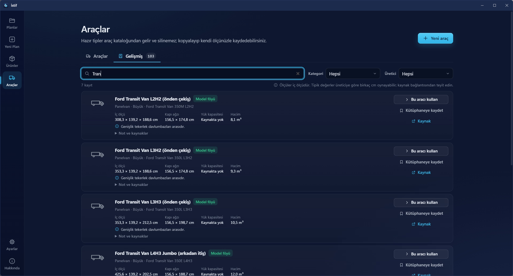

**Kütüphaneyi dışa ve içe aktarmak**

**Ayarlar** ekranındaki **Veri** bölümünde **Kütüphaneyi dışa aktar** ürün ve araç kütüphanenizi bir JSON dosyasına (`istif-kutuphane.json`) kaydeder. **Kütüphaneyi içe aktar** böyle bir dosyayı okur ve sorar: mevcut kütüphaneye **Ekle** mi, kütüphaneyi bununla **Değiştir** mi.

---

## 8. 3B görünüm

3B alan yerleşimi gösterir. Çok araçlı planlarda her araç ayrı sekmededir.

**Fareyle gezinme**

3B alandaki ipucu yazısı: "Sol tık: döndür · Sağ tık: kaydır · Tekerlek: yakınlaştır · Çift tık: odaklan".

- **Sürükle** (sol tuş): döndürür.
- **Sağ tuş**: kaydırır.
- **Tekerlek**: yakınlaştırır ve uzaklaştırır.
- **Bir parçaya çift tık**: kamera o parçaya odaklanır. Boş yere çift tık aracı kadraja sığdırır.

**Görünüm düğmeleri**

3B alanın sağ üstünde, simge ve adıyla beş düğme bulunur:

| Düğme | Ne gösterir |
|---|---|
| **İzometrik** | Yandan üstten çapraz bakış |
| **Yandan** | Aracın yan görünüşü |
| **Üstten** | Kuş bakışı |
| **Arkadan** | Kapıdan bakış (kapı **KAPI** yazısıyla işaretlidir) |
| **Sığdır** | Aracı kadraja tam sığdırır |

**Yakınlaştırma, PNG ve tam ekran**

3B alanın sağ kenarında yukarıdan aşağı şunlar durur: **Yakınlaştır** düğmesi, yakınlık çubuğu, **Uzaklaştır** düğmesi, **Görüntüyü PNG olarak kaydet** (kamera simgesi) ve **Tam ekran**. 3B alan seçiliyken `+` ve `−` tuşları da yakınlaştırır ve uzaklaştırır. PNG, o an gördüğünüz görünümü kaydeder.

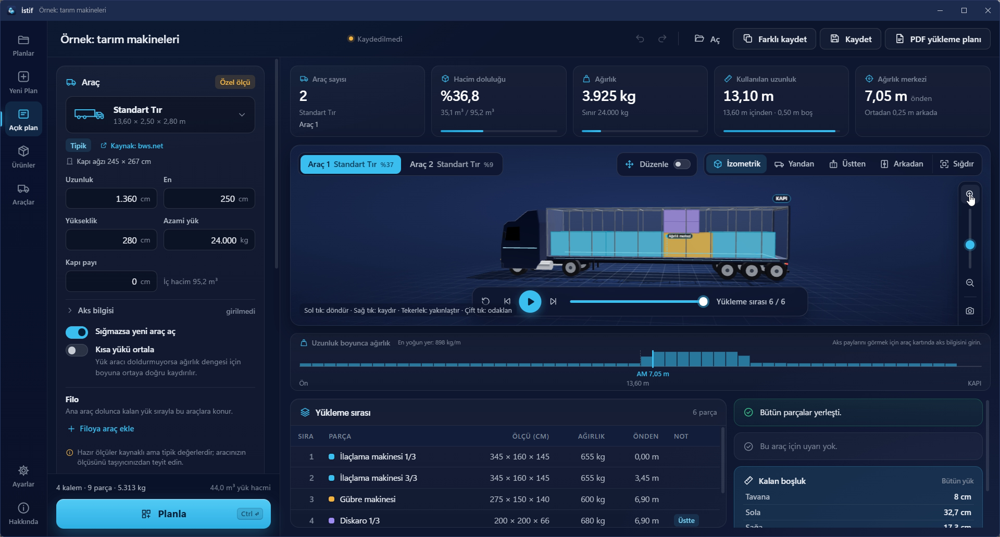

**Adım adım oynatma**

3B alanın altında oynatma çubuğu durur:

- **Oynat / Durdur**: parçalar yükleme sırasıyla yerine iner.
- **Önceki adım / Sonraki adım**: sırayı elle ilerletir.
- **Başa dön**: baştan başlatır.
- Yanındaki çubuğu sürükleyerek istediğiniz adıma atlayabilirsiniz.
- **Yükleme sırası 3 / 12** gibi bir sayaç görünür (sayılar örnektir).
- 3B alan seçiliyken `Boşluk` tuşu oynatır ve durdurur.

Oynatma sırasında **Yükleme sırası** tablosunda henüz yüklenmemiş satırlar soluk görünür, o anki satır vurgulanır.

**Parça seçmek**

- Bir parçanın üzerine gelin: **Ölçü**, **Ağırlık**, **Sıra** ve **Konum** (örneğin "önden 9,65 m, yerden 0,00 m") görünür. Başka parçanın üstündeyse "Başka parçanın üstünde", döndürülerek yerleştirildiyse "Döndürülerek yerleştirildi" de yazar.
- Bir parçaya tıklayın: parça vurgulanır, diğerleri soluklaşır.
- Boş yere tıklamak seçimi kaldırır.
- **Yükleme sırası** tablosundaki bir satıra tıklamak da parçayı seçer; aynı satıra yeniden tıklarsanız seçim kalkar. Satıra çift tıklayınca kamera o parçaya odaklanır.

3B görünüm açılamazsa "Bu bilgisayarda 3B görünüm açılamadı. Sonuçlar tabloda gösteriliyor." yazar.

---

## 9. Elle düzenleme

İstif parçaları kendisi yerleştirir. Farklı bir düzen isterseniz parçaları elle taşıyabilir, çevirebilir, duvara yaslayabilirsiniz. İstif her hareketi anında denetler ve araçta ne kadar yer kaldığını gösterir.

**Açmak**

Plan hesaplandıktan sonra 3B alanın üstündeki **Düzenle** anahtarını açın. (Sonuç yokken anahtar görünmez.) Açınca:

- Oynatma çubuğunun yerini düzenleme çubuğu alır. Bütün parçalar görünür, yükleme animasyonu durur.
- İpucu yazısı şuna döner: "Sürükle: taşı · Alt+sürükle: yükselt · Shift+sürükle: alan seç · Ctrl+tık: seçime ekle · Oklar: kaydır · R/T/Y: döndür · Esc: seçimi bırak".
- Üst çubukta, plan elle değiştirilince **Elle düzenlendi** etiketi çıkar.

Anahtarı kapatınca görünüm eskisi gibi olur; yaptığınız değişiklikler planda kalır.

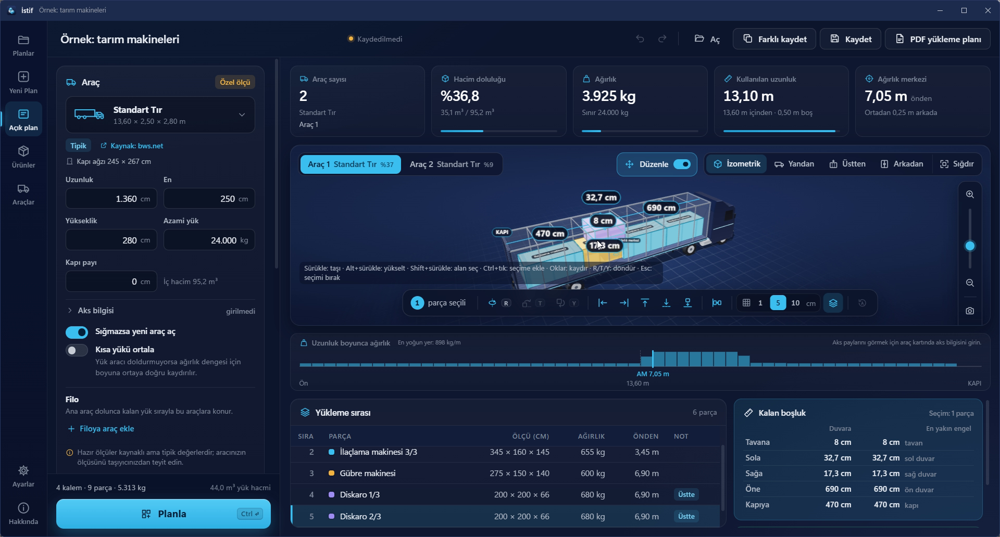

**Seçmek**

- **Tıklama**: bir parçayı seçer. Boş yere tıklamak seçimi bırakır.
- **Ctrl+tık**: parçayı seçime ekler ya da seçimden çıkarır. Böylece birden çok parça seçersiniz.
- **Shift+sürükle**: dikdörtgen alandaki parçaları seçer. `Ctrl` de basılıysa mevcut seçime eklenir.
- **Esc**: seçimi bırakır.
- **Yükleme sırası** tablosundaki satırlar 3B alanla birlikte izlenir: tabloda seçtiğiniz parça 3B'de de seçilir. Düzenleme açıkken tabloda `Ctrl+tık` ile de seçime ekleyebilirsiniz.
- **İstifi birlikte seç**: bu seçenek açıkken (varsayılan) bir parçayı seçince üstünde duran parçalar da seçilir ve birlikte taşınır. Düzenleme çubuğundaki aynı adlı düğmeyle açıp kapatırsınız.
- Düzenleme çubuğunun solunda seçili parça sayısı yazar: "1 parça seçili" ya da "Seçim yok".

Düzenleme kapalıyken tıklamak tek parçayı seçer ve ötekileri soluklaştırır. Düzenleme açıkken ötekiler soluklaşmaz; böylece engelleri görürsünüz.

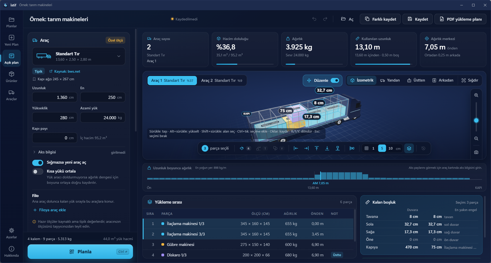

**Taşımak**

- **Sürükleyin**: parça (ya da seçili grup) araç tabanı düzleminde, yani sağa-sola ve ileri-geri hareket eder.
- **Alt tuşunu basılı tutarak sürükleyin**: parça yukarı ve aşağı hareket eder.
- Sürüklerken bırakacağınız yer yarı saydam bir çerçeveyle gösterilir.
- Bıraktığınızda parça **ızgara adımına** oturur, duvarlara ve komşu parçaların yüzlerine yakınsa onlara yapışır, araç dışına çıkamaz. Sonra alttaki yüzeye iner; havada bıraktığınız parça yere ya da altındaki parçanın üstüne oturur.
- **Izgara adımı** düzenleme çubuğunda seçilir: 1, 5 ya da 10 cm (imperial'de 1, 2 ya da 4 in). Varsayılan 5 cm'dir. Seçiminiz bir sonraki açılışta da hatırlanır.
- **Ok tuşları** seçili parçayı bir ızgara adımı kaydırır; ok yönü kamerada gördüğünüz yöne göredir. `Shift` ile on adım kayar. `Page Up` ve `Page Down` yukarı ve aşağı taşır.

**Döndürmek**

Düzenleme çubuğunda üç döndürme düğmesi vardır. Klavyede de aynı harflerle çalışırlar:

| Düğme | Tuş | Ne yapar |
|---|---|---|
| **Yatayda 90° döndür** | `R` | Parçayı yerinde, yatayda 90° çevirir. |
| **Yana yatır** | `T` | Parçayı yan yatırır. |
| **Öne yatır** | `Y` | Parçayı öne yatırır. |

Parçanın **Yön** kuralına uyulur: **Serbest** parçada üçü de çalışır, **Dik** parçada yalnız `R`, **Sabit** parçada hiçbiri. Çalışmayan düğme gri görünür; üzerine gelince nedenini yazar, örneğin "İlaçlama makinesi" döndürülemez (yön: sabit). Birden çok parça seçiliyse hepsi ortak merkezleri etrafında birlikte döner. Döndürme animasyonla yapılır.

**Yaslamak**

Döndürme düğmelerinin yanındaki beş simgeli düğme parçayı yaslar. Sırasıyla: **Sol duvara yasla**, **Sağ duvara yasla**, **Öne yasla (kabine doğru)**, **Arkaya yasla (kapıya doğru)**, **Yere indir**. Seçim yoksa bütün yük kayar. O yönde yer yoksa "Bu yönde boşluk yok." yazar.

**Boşluğu kapat** seçimi, seçim yoksa bütün yükü öne, kabine doğru yaslar.

Düzenleme çubuğundaki yazılı düğmeler (**Boşluğu kapat**, **İstifi birlikte seç**, **Otomatik plana dön**) pencere daralınca yalnız simgeye dönüşür. Simgenin üstüne gelince adı görünür; yaslama ve döndürme düğmelerinin adı her zaman yalnız üstlerine gelince görünür.

**Kalan boşluk ve ölçü çizgileri**

Seçili parçanın (ya da seçili grubun) tavana, sola, sağa, öne ve kapıya kaç cm kaldığı iki yerde gösterilir:

- 3B alanda ölçü çizgileri ve etiketleri olarak.
- Sağ alttaki **Kalan boşluk** panelinde liste olarak. Seçim varsa panelin üstünde "Seçim: 1 parça" gibi yazar ve iki sütun vardır: **Duvara** ve **En yakın engel**. En yakın engel sütununda engelin adı yazar: başka bir parçanın adı ya da tavan, sol duvar, sağ duvar, ön duvar, kapı. Satırlar **Tavana**, **Sola**, **Sağa**, **Öne**, **Kapıya** diye sıralanır.
- Seçim yoksa panelde **Bütün yük** yazar ve yükün dış kutusundan duvarlara kalan boşluk gösterilir.
- Sürüklerken sayılar canlı değişir.
- Araçta kapı payı varsa kapıya kalan boşluktan düşülür: "Kapıya kalan boşlukta kapı payı düşülmüştür."
- Araçta hiç parça yoksa "Araçta parça yok." yazar.

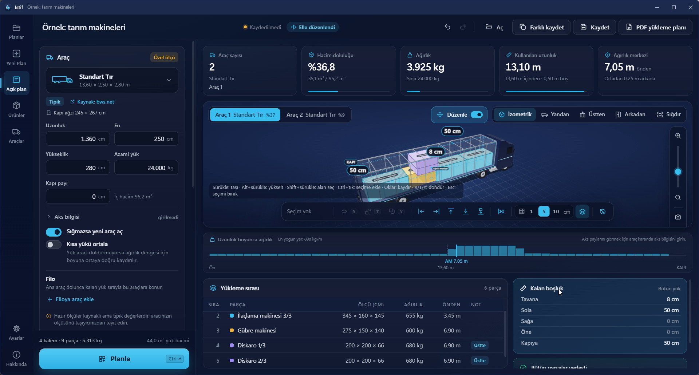

**Anlık denetim ve kırmızı uyarı**

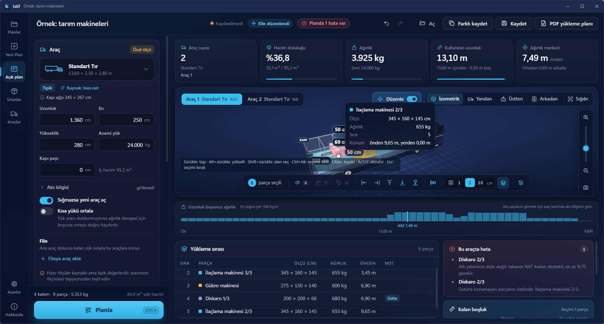

Her değişiklikten sonra İstif bütün yerleşimi denetler.

- Kuralı bozan parça **kırmızı** yanar ve hafifçe sarsılır.
- Sağ alttaki **Bu araçta hata** kutusu parçanın adını ve nedenini yazar. Satıra tıklarsanız parça seçilir ve kamera ona döner.
- **Yükleme sırası** tablosunda o parçanın notunda **Hata** etiketi görünür.
- Üst çubukta **Planda … hata var** etiketi çıkar. Tıklarsanız ilk hatalı parçaya gider.
- Kırmızı hata nedenleri şunlardır: araç sınırının dışına taşıma, kapı payına girme, başka parçayla çakışma, parçanın havada durması, altının yeterince dolu olmaması (tabanın en az %70'inin desteklenmesi gerekir), yalnız zemin kuralı bozulması, üstüne konamayan parçanın üstünde durma, üst yük sınırının aşılması, döndürme kuralının bozulması, parçanın ölçülerinin kalemin ölçüleriyle uyuşmaması (kalemin ölçüsü elle düzenlemeden sonra değiştirildiyse) ve araç geneli için tonaj aşımı.
- **Sarı** uyarı yalnız teslimat sırası içindir: sonra indirilecek bir parça, önce indirilecek parçanın önünü kapatıyorsa **Teslimat sırası** kutusu ve tabloda **Uyarı** etiketi görünür.

Hatalı planı yine de kaydedebilir ve PDF'e çevirebilirsiniz; PDF'in başına "Bu planda … hata var. Yüklemeden önce hataları düzeltin." notu yazılır.

Her değişiklikten sonra özet kartları, ağırlık merkezi, aks payları, **Uzunluk boyunca ağırlık** şeridi ve **Yükleme sırası** tablosu yeni yerleşime göre yeniden hesaplanır.

**Geri almak**

- Her elle düzenleme adımı geri al geçmişine girer: üst çubuktaki geri al ve yinele düğmeleri ya da `Ctrl + Z` ve `Ctrl + Y`. Geri alınca parça eski yerine süzülür.
- **Otomatik plana dön** (düzenleme çubuğundaki son düğme) bütün elle değişiklikleri atar ve hesaplanan yerleşime döner. Plan elle değiştirilmediyse düğme gridir: "Plan elle değiştirilmedi."
- Elle düzenlenmiş planda **Planla**'ya basarsanız İstif sorar: **Elle düzenlenmiş plan** / "Elle yaptığınız değişiklikler kaybolacak, devam edilsin mi?" **Yeniden planla**'ya basarsanız yeni hesap elle yaptıklarınızı siler.

**Kaydetmek ve PDF**

Elle düzenlenmiş plan `.istif` dosyasına kaydedilir ve açınca aynen gelir; plan açılırken denetim yeniden yapılır. PDF yeni yerleşimle hazırlanır ve her araç için kalan boşluk tablosu içerir (bölüm 11).

**Animasyonlar**

Bırakınca yumuşak oturma, ok tuşlarıyla kayarak taşıma, döndürme ve yaslama hareketleri, geri alınca parçanın eski yerine süzülmesi ve ölçü çizgilerinin belirmesi animasyonludur. **Ayarlar**'daki **Animasyonlar** seçeneğiyle kapatabilirsiniz (bölüm 14).

---

## 10. Sonucu okumak

**Özet kartları**

| Kart | Anlamı |
|---|---|
| **Araç sayısı** | Planın kaç araç kullandığı. Altında seçili aracın tipi ve (birden çok araç varsa) sekme adı yazar. |
| **Hacim doluluğu** | Yükün araç hacmine oranı (yüzde). Altında "dolu / toplam" hacim m³ olarak yazar; kapı payı varsa toplam hacimden düşülür. |
| **Ağırlık** | Seçili araçtaki yükün toplam ağırlığı ve aracın sınırı ("Sınır … kg" ya da "Ağırlık sınırı yok"). Sınırın %90'ını geçince altındaki çubuk sarıya, sınır aşılınca kırmızıya döner. |
| **Kullanılan uzunluk** | Yükün kasada kapladığı boy (en arkadaki parçanın bittiği yer) ve toplam uzunluktan kaç metrenin boş olduğu. |
| **Ağırlık merkezi** | Yükün ağırlık merkezinin önden kaç metrede olduğu. Altında "Boyuna ortada" ya da ortadan ne kadar önde ya da arkada olduğu yazar. Aks bilgisi girildiyse **Şasi … · Aks …** da görünür. |

Araç sayısı dışındaki kartlar seçili aracın değerlerini gösterir.

**Araç sekmeleri**

Plan birden çok araç kullanıyorsa 3B alanın üstünde **Araç 1**, **Araç 2**… sekmeleri çıkar. Sekmede aracın tipi ve doluluk yüzdesi yazar. Sekmeyi değiştirince özet kartları, 3B alan, ağırlık şeridi, tablo ve uyarılar o aracı gösterir.

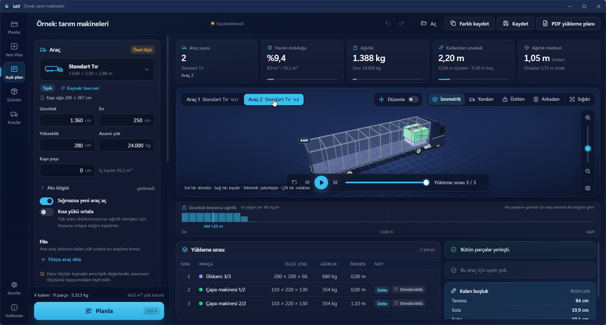

**Uzunluk boyunca ağırlık**

3B alanın altındaki şerit, her parçanın ağırlığının kapladığı uzunluğa eşit yayıldığını varsayarak metre başına yükü çubuklarla gösterir. Üstünde "En yoğun yer: … kg/m" yazar; bir çubuğun üstüne gelince o dilimin aralığı ve yükü çıkar. Şeritte ağırlık merkezi (**AM …**) ve aracın ortası işaretlidir; kapı payı varsa o bölge ayrıca işaretlenir. Sol uçta **Ön**, ortada aracın uzunluğu, sağ uçta **KAPI** yazar. Aks bilgisi girildiyse şasi kilidi ve aks grubu da burada işaretlenir.

**Aks payı**

Aracın aks bilgisi girilmişse özet **Şasi … · Aks …** olarak, şasiye ve aks grubuna düşen yük payını kg olarak gösterir. Aks payı ve ağırlık merkezi **tahminidir**. Yalnız yükten gelen payı gösterir; boş aracın kendi ağırlığı hesaba girmez.

**Kısa yükü ortala**

Bu anahtar açıkken ve yük aracı doldurmuyorsa bütün yük, parçaların birbirine göre düzeni bozulmadan, ağırlık dengesi için kapıya doğru kaydırılır. Hedef, ağırlık merkezinin şasi kilidi ile aks grubu arasının ortasına (aks bilgisi yoksa kullanılabilir uzunluğun ortasına) gelmesidir. Yük öne çekilmez. Kaydırma yapılırsa **Uyarılar**'da "Yük, ağırlık dengesi için … m geriye alındı; arkasını kayışla sabitleyin." yazar.

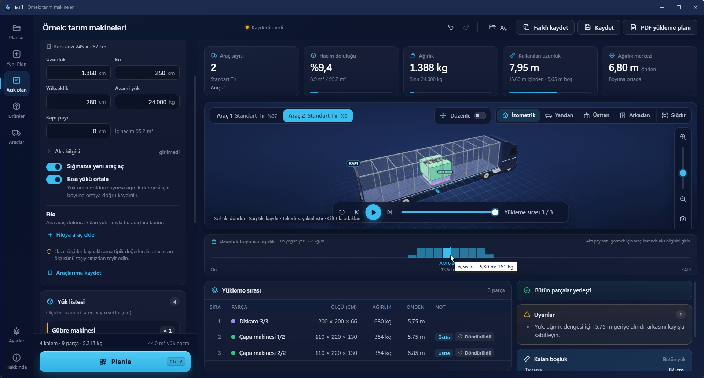

**Uyarılar**

**Uyarılar** kutusu seçili araç için uyarıları listeler. Uyarı yoksa "Bu araç için uyarı yok." yazar. Başlıca uyarılar: ağırlık merkezinin aks grubunun arkasında ya da şasi kilidinin önünde kalması, yükün yanlara dengesiz olması, tonajın aşılması, yükün geriye alınması. Hesap süre sınırına ulaşırsa "Hesap süre sınırına ulaştı, sonuç yine geçerli." yazar.

Kapı ağzı bilinen bir araçta kapı ağzından geçmeyen kalem varsa ayrı bir **Kapı ağzı** kutusu çıkar. Kutuda her kalemin adı ve altında "araç: kapı ağzı ölçü" satırı yazar. Yük listesinde o kalemde **Kapıdan geçmez** etiketi görünür; üzerine gelince "En küçük iki ölçüsü aracın kapı ağzından büyük." açıklaması çıkar.

**Sığmayanlar**

Yerleşemeyen parçalar **Sığmayanlar** başlığında, nedeniyle birlikte listelenir:

| Neden | Anlamı |
|---|---|
| araca hiçbir yönde sığmıyor | Parçanın ölçüsü araçtan büyük. |
| tonaj sınırı | Araç ağırlık sınırı dolmuş ya da parça tek başına bütün araçların ağırlık sınırından ağır. |
| kurallar izin vermiyor | Üstüne konamaz, yalnız zemin gibi kurallar yer bırakmamış. |
| parça sınırı ya da araç dolu | Bir hesapta en çok 300 parça yerleştirilir (adetler açıldıktan sonra). Ayrıca **Sığmazsa yeni araç aç** kapalıyken ya da filodaki araçlar bittiğinde artan parçalar buraya düşer. |

Her şey yerleştiyse "Bütün parçalar yerleşti." yazar.

Sığmayan parça varsa şunları deneyin: daha büyük bir araç seçin, **Sığmazsa yeni araç aç**'ı açın, filoya araç ekleyin, kapı payını küçültün ya da kuralları gözden geçirin.

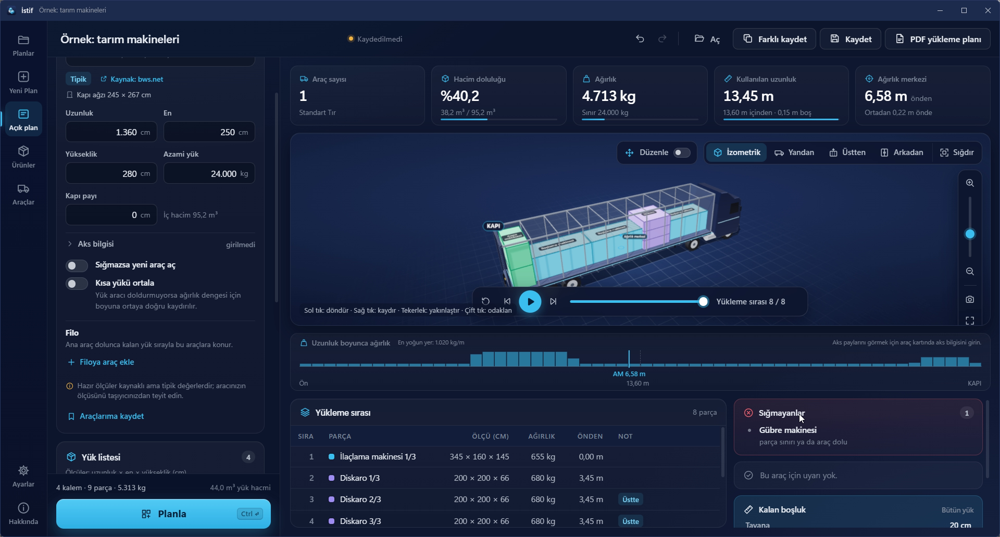

**Yükleme sırası tablosu**

Tabloda her parça için sıra, ad, ölçü (cm), ağırlık, önden uzaklık (m) ve not bulunur. Notlar: **Üstte**, **Döndürüldü**; elle düzenlerken **Hata** ve **Uyarı**. Satıra tıklamak parçayı seçer, çift tıklamak kamerayı ona odaklar.

**Planlama sırası**

İstif önce yerleştiremediği parça sayısını (eşitse hacmini) en aza indirmeye çalışır. Sonra en az aracı kullanmayı, sonra kullanılan araçların toplam iç uzunluğunu kısaltmayı, sonra son aracın kullanılan uzunluğunu kısaltmayı, sonra ağırlık merkezini ortaya yaklaştırmayı hedefler. Hesap, güvenlik için konan süre sınırına takılmadıkça aynı girdi her zaman aynı planı verir.

---

## 11. PDF yükleme planı

PDF, depo çalışanı ve şoför içindir. Planlama bittikten sonra sağ üstteki **PDF yükleme planı** düğmesine basın.

1. Önce planlayın. Plan hesaplanmadıysa düğme soluktur ve basılamaz.
2. **PDF yükleme planı**'na tıklayın. Düğmede **PDF hazırlanıyor…** yazar.
3. **PDF olarak kaydet** penceresinde yeri seçin. Önerilen dosya adı "plan adı - yükleme planı" biçimindedir.
4. Kaydedince "PDF kaydedildi." bildirimi ve **Klasörde göster** bağlantısı çıkar.

Girdiler son hesaptan sonra değiştiyse İstif **Sonuç güncel değil** penceresiyle uyarır. **Yine de hazırla** derseniz PDF son hesaplanan yerleşimle hazırlanır.

**PDF'te neler var** (A4 yatay, açık zeminli)

İlk sayfa özettir:

- Plan adı, "Yükleme planı" ve tarih-saat. Plan elle düzenlendiyse **Elle düzenlendi** de yazar. Hata varsa bu başlığın altında, özet kutularından önce hata notu çıkar.
- Araç tipi, iç ölçü ve azami yük, araç sayısı, yerleşen parça sayısı ve toplam ağırlık.
- **Araçlar** tablosu: her araç için parça sayısı, hacim doluluğu, ağırlık / sınır, kullanılan uzunluk, ağırlık merkezi ve aks payları.
- **Kalan boşluk** tablosu: her araç için yükün tavana, sola, sağa, öne ve kapıya kalan mesafesi.
- **Uyarılar** ve **Sığmayanlar** kutuları.
- **Yük listesi**: kalem, ölçü, ağırlık, adet ve kurallar.

Sonraki sayfalarda her araç için bir sayfa vardır: araç başlığı, parça sayısı, ağırlık, doluluk ve kullanılan uzunluk, kalan boşluk satırı, üç 3B görüntü (izometrik, üstten ve yandan) ve **Yükleme sırası** tablosu (sıra, parça, ölçü, ağırlık, önden uzaklık ve not). Uzun tablolar sayfaya bölünür, başlık satırı her sayfada tekrar eder.

Her sayfanın altında "İstif … ile hazırlandı · Hesaplar planlama içindir; yük güvenliği ve yasal sınırlar için taşıyıcınızın kurallarını uygulayın." notu ve sayfa numarası bulunur.

3B görünüm açılamadıysa ilgili yerde "3B görüntü alınamadı." yazar.

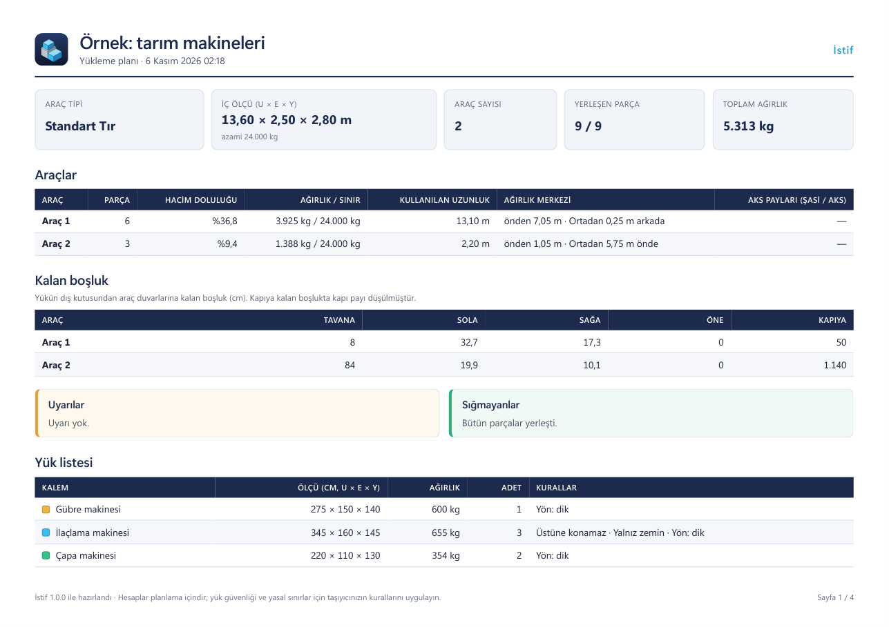

---

## 12. Excel'den yük almak

Yük listenizi Excel'de hazırladıysanız tek tek girmeniz gerekmez.

**Dosya türleri:** `.xlsx`, `.xls` ve CSV. Dosya en çok 20 MB olabilir. Dosya yerelde okunur; hiçbir yere gönderilmez.

**Adımlar**

1. Plan ekranında **Excel'den al**'a tıklayın. **Excel'den yük al** penceresi açılır.
2. İsterseniz önce **Şablonu indir** ile hazır başlıklı dosyayı kaydedin (`istif-yuk-sablonu.xlsx`) ve yükünüzü içine yazın.
3. **Dosya seç…** ile dosyanızı açın. İlk satır sütun başlıkları olmalı. Dosyada birden çok sayfa varsa **Sayfa** listesinden seçersiniz.
4. **Sütunları eşleştirin** penceresi açılır. Her alan için dosyanızdaki sütunu seçin. İstif başlıklara bakıp eşlemeyi kendisi tahmin eder; yanlışsa değiştirin. **zorunlu** yazan alanlar boş bırakılamaz.
5. **Ölçü birimi**ni (mm, cm, m ya da in) ve **Ağırlık birimi**ni (kg ya da lb) kontrol edin. İstif birimi başlıklardan (ör. "Uzunluk (cm)") ya da değerlerden tahmin eder; yanlışsa değiştirin.
6. **Önizleme (ilk 10 satır)** satırları gösterir. Sütunlar: **Satır**, **Ad**, **Ölçü**, **Ağırlık**, **Adet**, **Kurallar**, **Durum**. Uygun satırda **Uygun**, hatalı satırda nedeni yazar (ör. "Ölçü eksik ya da hatalı", "Ölçü çok büyük; birimi denetleyin").
7. **Ekle (… kalem)**'e tıklayın. Hatalı satırlar eklenmez, geri kalanlar (yalnız ilk 10 satır değil, dosyadaki bütün uygun satırlar) listeye girer. Zorunlu sütunlar eşleşmemişse düğme soluk kalır ve "Zorunlu sütunlar eşleşmedi: …" yazar.

**Sütunlar**

| Alan | Zorunlu mu |
|---|---|
| **Ad** | Evet |
| **Referans** | Hayır |
| **Uzunluk / boy** | Evet |
| **En** | Evet |
| **Yükseklik** | Evet |
| **Ağırlık** | Hayır. Boşsa 0 kabul edilir. Tek parçanın ağırlığıdır. |
| **Adet** | Hayır. Boşsa 1 kabul edilir. |
| **Üstüne konamaz**, **Yalnız zemin** | Kural sütunu, isteğe bağlı |
| **Yön** | Kural sütunu, isteğe bağlı |
| **Üst yük sınırı** | Kural sütunu, isteğe bağlı |
| **Teslimat sırası** | Kural sütunu, isteğe bağlı |

**Kural sütunlarına ne yazılır**

- Evet demek için: `evet`, `e`, `var`, `x`, `1`, `true`, `doğru`, `yes`, `y`, `✓`
- Hayır demek için: `hayır`, `hayir`, `h`, `yok`, `0`, `false`, `yanlış`, `no`, `n` ya da boş bırakın. Tanınmayan bir yazı da hayır sayılır.
- **Yön** için: `serbest` (ya da `her yön`, `free`, `any`), `dik` (ya da `dikey`, `upright`, `vertical`), `sabit` (ya da `döndürülmez`, `fixed`, `no rotation`). Boş bırakırsanız ya da tanınmayan bir yazı olursa **Serbest** olur.
- Programın dili Türkçe ya da İngilizce dışındaysa o dilin sözcükleri de kabul edilir.

---

## 13. Plan kaydetme ve açma

Planlar `.istif` uzantılı dosyalara kaydedilir.

- **Kaydet** (`Ctrl + S`): planı kaydeder. İlk kayıtta **Planı kaydet** penceresi açılır, yer ve ad sorulur.
- **Farklı kaydet** (`Ctrl + Shift + S`): planı yeni bir adla kaydeder.
- **Aç** ya da **Plan aç…** (`Ctrl + O`): **Plan aç** penceresiyle bir `.istif` dosyası açar. Dosyayı program penceresine sürükleyip bırakmak da açar.
- **Yeni Plan** (`Ctrl + N`): boş plan açar.
- **Son planlar**: **Planlar** ekranında son açtığınız ve kaydettiğiniz en çok 10 plan listelenir. Her kartta plan adı, araç, tarih, araç sayısı, parça sayısı, ağırlık ve doluluk yazar. Karttaki klasör simgesi (**Klasörde göster**) dosyanın yerini açar. Dosyası silinmiş ya da taşınmış plan listede görünmez. Pencereye sürükleyip bıraktığınız plan bu listeye eklenmez.

Kaydedilmemiş değişiklik varken yeni plan ya da başka bir plan açmak isterseniz İstif **Kaydedilmemiş değişiklikler** penceresiyle sorar: **Kaydetmeden devam et** ya da vazgeçin. Programdan çıkmak isterseniz **Çıkmadan önce** penceresi çıkar: **Kaydet ve çık**, **Kaydetmeden çık** ya da **Vazgeç**.

**Çift tıkla açmak.** Kurulum paketiyle kurduysanız `.istif` dosyasına çift tıklayınca plan İstif'te açılır. Taşınabilir sürümde ilişkilendirme yoktur; planı **Aç** ile ya da dosyayı pencereye sürükleyerek açın.

**Dosya.** `.istif` dosyası düz JSON metnidir, en çok 50 MB olabilir. Plan dosyası sizde kalır; İstif onu hiçbir yere göndermez. Dosyayı e-postayla ya da paylaşımlı klasörle meslektaşınıza verebilirsiniz. Elle düzenlenmiş yerleşim de dosyada saklanır (bölüm 9).

**Geri al ve yinele.** Plan girdilerindeki (araç, kalem, seçenek) ve elle düzenlemedeki değişiklikler geri alınabilir: üst çubuktaki simgeler ya da `Ctrl + Z` / `Ctrl + Y`. Geçmiş en çok 100 adım tutar. Bir alana yazarken yaptığınız değişiklik tek adım sayılır. Yazı alanındayken `Ctrl + Z` alanın kendi geri almasıdır.

**Otomatik taslak.** Kaydedilmemiş değişiklik varken İstif 30 saniyede bir taslak yazar. Program olağan kapanınca taslak silinir. Elektrik kesintisi ya da çökme olursa bir sonraki açılışta **Kaydedilmemiş plan** penceresi çıkar: "Program beklenmedik biçimde kapandı ve kaydedilmemiş bir plan bulundu. Geri yüklensin mi?" **Geri yükle** ya da **Silinsin** dersiniz.

**Verileriniz nerede?**

- `%APPDATA%\Istif\`: ürün ve araç kütüphaneniz (`kutuphane.json`), son planlar (`son-planlar.json`), ayarlar (`ayarlar.json`) ve otomatik taslak (`taslak.json`). **Ayarlar** > **Veri** > **Veri klasörünü aç** bu klasörü açar.
- `%LOCALAPPDATA%\Istif\`: WebView2 önbelleği ve hata günlüğü (`gunluk.txt`).

İstif'i kaldırdığınızda bu klasörler silinmez; kullanıcı veriniz yerinde kalır.

---

## 14. Dil, tema ve ayarlar

Sol şeritteki **Ayarlar** ekranı şu bölümlerden oluşur: **Görünüm** (**Dil**, **Tema**, **Animasyonlar**, **Birimler**), **Planlama** (**Varsayılan araç**), **Güncellemeler** ve **Veri**. Ayarlar bu bilgisayarda saklanır.

**Dil.** İstif 12 dilde kullanılır: Türkçe, İngilizce, Almanca, Fransızca, İspanyolca, İtalyanca, Portekizce, Rusça, Arapça, Çince, Japonca ve Korece. Dil listesinin ilk seçeneği **Sistem dili (…)**'dir ve varsayılandır: Windows'un görüntü dilini izler. Windows dili desteklenen diller arasında değilse İngilizce açılır. Dili değiştirdiğinizde programı kapatıp açmanız gerekmez: arayüz yeniden yüklenir, açık planınız korunur. Bir dilin çevirisinde eksik metin varsa o metin İngilizce görünür. Arapçada arayüz sağdan sola düzenle çizilir.

**Tema.** **Sistem**, **Koyu** ya da **Açık**. **Sistem**, Windows'un açık ya da koyu uygulama ayarını izler. Tema hemen uygulanır.

**Animasyonlar.** **Açık** (varsayılan): parçalar düşerek yerleşir, düzenlerken kayar ve döner. **Sistem**: Windows'un animasyon efektleri ayarını izler. **Kapalı**: hiçbir animasyon yoktur. Hemen uygulanır.

**Birimler.** **Metrik (cm, kg)** ya da **Imperial (in, lb)**. Ölçü ve ağırlıklar bu birimle girilir ve gösterilir (PDF ve Excel'den alma dahil). Hesap her zaman milimetre ve kilogramla yapılır. Birimi değiştirince de arayüz yeniden yüklenir ve açık plan korunur.

**Varsayılan araç.** Yeni planlar bu araçla açılır.

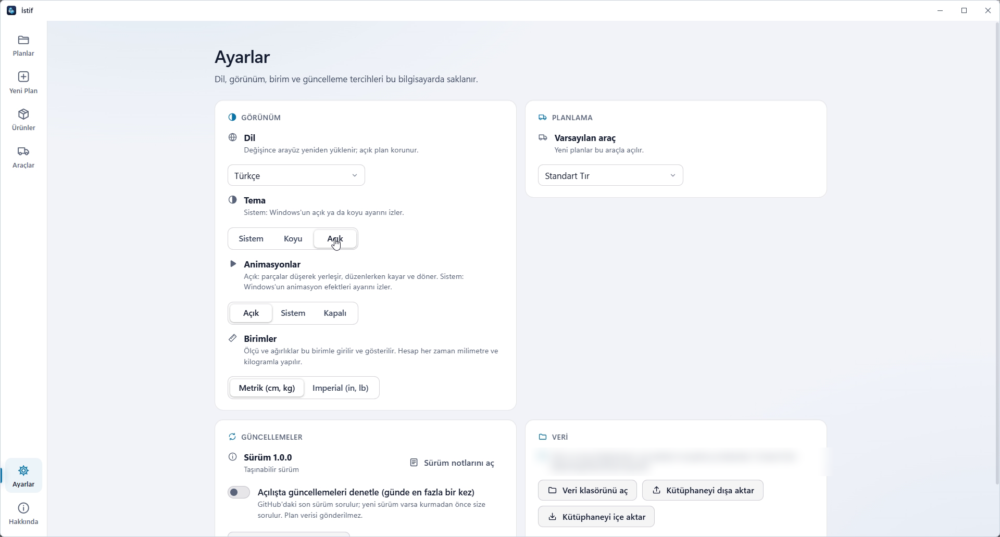

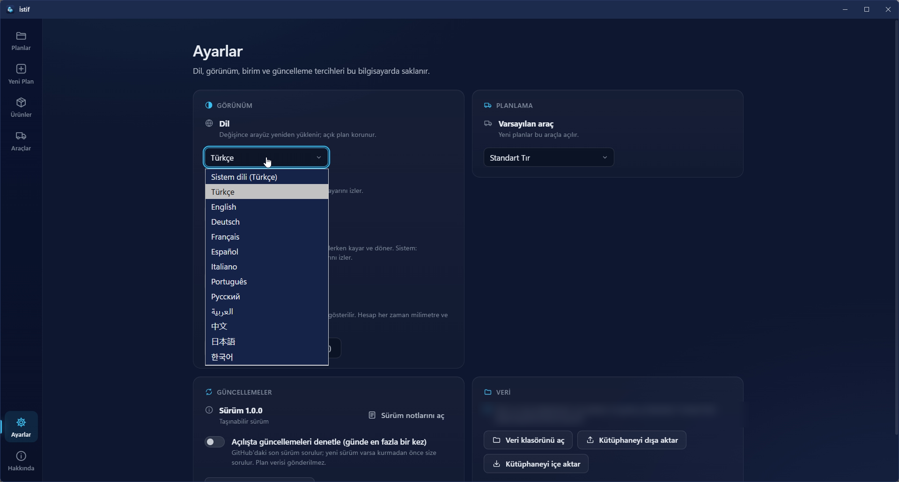

---

## 15. Güncellemeler

İstif yalnız güncelleme denetimi için internete çıkar. Plan ve yük verisi gönderilmez.

- Açılışta, **Açılışta güncellemeleri denetle (günde en fazla bir kez)** anahtarı açıksa ve son denetimden 24 saat geçmişse İstif GitHub'daki son sürümü sorar. Anahtar varsayılan olarak açıktır.
- Yeni sürüm varsa **Yeni sürüm: …** penceresi açılır. Pencerede "Bu sürümde" başlığı altında değişiklikler programın dilinde yazar (o dilde not yoksa İngilizcesi, o da yoksa GitHub'daki sürüm açıklaması). **Güncelle** ya da **Sonra** seçersiniz. Siz onaylamadan hiçbir şey indirilmez ve kurulmaz.
- **Güncelle**'ye bastığınızda açık planda kaydedilmemiş değişiklik varsa İstif "Güncellemeden önce açık planı kaydetmek ister misiniz?" diye sorar.
- İndirme sırasında **İndiriliyor %…** yazar. İndirilen dosya, sürümle birlikte yayınlanan `SHA256SUMS.txt` içindeki SHA-256 özetiyle karşılaştırılır. Özet uyuşmazsa dosya silinir ve kurulmaz. Sürümde `SHA256SUMS.txt` yoksa ya da dosya listede yoksa da kurulmaz.
- Kurulum paketiyle kurduysanız yeni kurulum paketi indirilir ve sessizce çalışır; kurulumdan sonra program yeniden açılır. Taşınabilir sürümde yeni `Istif.exe` indirilir; program kapanır, dosyanın üzerine yazılır ve yeniden açılır. Hangisini kullandığınız **Ayarlar** > **Güncellemeler** altında yazar: **Kurulum paketiyle kuruldu** ya da **Taşınabilir sürüm**.
- Bir sorun olursa **Güncelleme yapılamadı.** ve nedeni yazar.

**Elle denetlemek:** **Ayarlar** > **Güncellemeler** bölümünde **Güncellemeleri denetle**'ye tıklayın. Yeni sürüm yoksa yanında "Yeni sürüm bulunamadı." yazar. **Hakkında** ekranındaki **Güncelleme ayarları** düğmesi sizi **Ayarlar** ekranına götürür.

**Kapatmak:** **Ayarlar** > **Güncellemeler** bölümünde **Açılışta güncellemeleri denetle (günde en fazla bir kez)** anahtarını kapatın. `Istif.exe --cevrimdisi` ile açarsanız o oturumda açılışta denetlenmez; **Güncellemeleri denetle** düğmesi yine çalışır.

**Sürüm notları:** **Sürüm notlarını aç** düğmesi (**Ayarlar** ve **Hakkında** ekranlarında) bu sürümde ve önceki sürümlerde neler değiştiğini gösterir.

---

## 16. Kısayollar

**Genel**

| Kısayol | İşlem |
|---|---|
| `Ctrl + N` | Yeni plan |
| `Ctrl + O` | Plan aç |
| `Ctrl + S` | Planı kaydet |
| `Ctrl + Shift + S` | Farklı kaydet |
| `Ctrl + Enter` | Planla (plan ekranında) |
| `Ctrl + Z` | Geri al (plan ekranında) |
| `Ctrl + Y` | Yinele (plan ekranında; `Ctrl + Shift + Z` de çalışır) |
| `Boşluk` | Oynat / durdur (3B alan seçiliyken; düzenleme kapalıyken) |
| `+` ve `−` | Yakınlaştır / uzaklaştır (3B alan seçiliyken) |

**3B alanda fare:** sol tık döndürür, sağ tık kaydırır, tekerlek yakınlaştırır, çift tık odaklanır.

**Elle düzenleme açıkken**

| Kısayol | İşlem |
|---|---|
| Sürükle | Taşı |
| `Alt` + sürükle | Yükselt (yukarı ve aşağı taşı) |
| `Shift` + sürükle | Alan seç |
| `Ctrl` + tık | Seçime ekle / seçimden çıkar |
| Ok tuşları | Bir ızgara adımı kaydır (`Shift` ile on adım) |
| `Page Up` / `Page Down` | Yukarı / aşağı taşı |
| `R` / `T` / `Y` | Yatayda döndür / yana yatır / öne yatır |
| `Esc` | Seçimi bırak (sürükleme sürerken sürüklemeyi iptal eder) |

**Listelerde:** Karışık filo listesinde `Alt + ↑/↓` sırayı değiştirir, `Delete` aracı çıkarır. Yük listesinde `Enter` kalemi düzenler, `Delete` siler. Sol şeritte `↑/↓` öğeler arasında dolaşır.

Bu kısayolların bir bölümü **Hakkında** ekranında da listelenir.

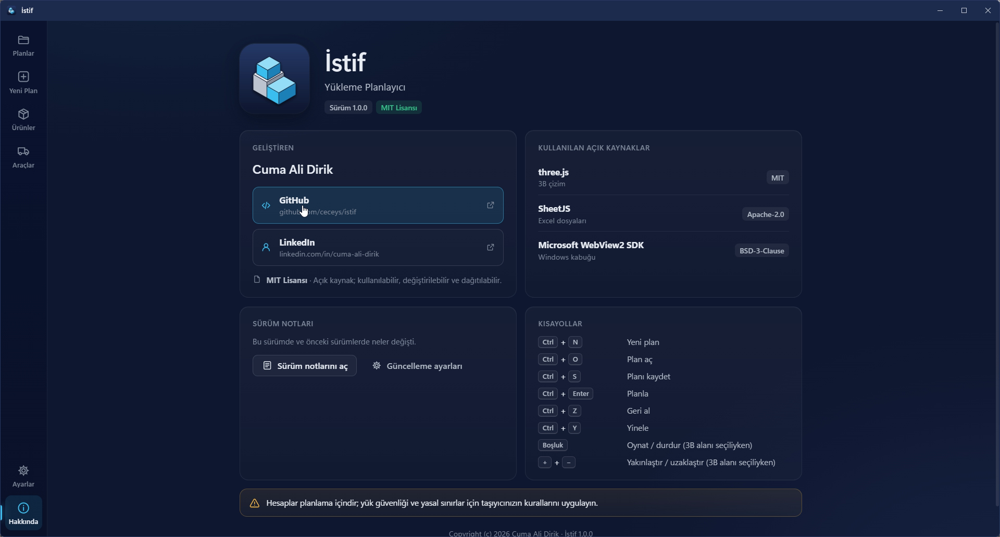

---

## 17. Sık sorulanlar

**İstif ücretsiz mi?**
Evet. MIT lisanslı açık kaynak bir programdır. Kaynak kodu [GitHub'da](https://github.com/ceceys/istif).

**Hangi Windows sürümlerinde çalışır?**
64 bit Windows 10 (sürüm 1809 ve sonrası) ve Windows 11'de. Ayrıca .NET 8 Desktop Runtime ve WebView2 Runtime gerekir (bölüm 1).

**Verilerim bir yere gönderiliyor mu?**
Hayır. Plan ve yük verisi hiçbir yere gönderilmez. Program yalnız güncelleme denetimi için internete çıkar. Araç kataloğundaki kaynak bağlantılarını İstif kendisi açmaz; yalnız siz tıklayınca varsayılan tarayıcınızda açılır.

**İnternetsiz çalışır mı?**
Evet. Planlama, 3B görünüm, PDF ve Excel okuma internet gerektirmez. Güncelleme denetimi yapılamazsa program yine açılır. `Istif.exe --cevrimdisi` ile açarsanız açılışta denetlemez.

**Aynı yükü iki kez planlarsam aynı sonucu alır mıyım?**
Evet. Hesap, güvenlik için konan süre sınırına takılmadıkça aynı girdi her zaman aynı planı verir.

**Araç ölçüsünü ben mi girmeliyim?**
İsterseniz hazır tipi ya da katalogdan bir aracı seçin, isterseniz ölçüyü kendiniz girin. Hazır ölçüler tipik değerlerdir; gerçek ölçüyü taşıyıcınızdan teyit edin.

**Bir parça neden sığmadı?**
**Sığmayanlar** kutusu nedenini yazar (bölüm 10).

**Planı değiştirdim ama sonuç eski kaldı.**
Girdiler değişince sonuç eskir ve 3B alanın üstünde uyarı çıkar. **Planla**'ya yeniden basın. Elle düzenlenmiş planda yeniden planlamak elle yaptıklarınızı siler; İstif önce sorar.

**Aks payı neden gösterilmiyor?**
Aracın aks bilgisi girilmemiştir. Bölüm 4'e bakın.

**Aks payı ve ağırlık merkezi kesin mi?**
Hayır, tahmindir.

**Hangi dosyaları açar?**
`.istif` plan dosyaları, Excel (`.xlsx`, `.xls`) ve CSV yük listeleri. Kütüphane içe aktarma için `.json`.

**3B görünüm açılmıyor.**
İstif 3B görünümü başlatamazsa "Bu bilgisayarda 3B görünüm açılamadı. Sonuçlar tabloda gösteriliyor." der; sonuçlar yine tablolarda görünür. PDF'te de 3B görüntülerin yerine "3B görüntü alınamadı." yazar.

**Hata bulursam ne yapmalıyım?**
[GitHub'da bir issue açın](https://github.com/ceceys/istif/issues/new/choose). Bildirime şunları ekleyin: İstif sürümü (**Hakkında** ekranında yazar), Windows sürümü, sorunu çıkaran araç ve yük (paylaşabiliyorsanız) ve `%LOCALAPPDATA%\Istif\gunluk.txt` dosyasının son satırları. Günlük dosyası hata iletilerini içerir ve dosya yolları geçebilir; özel bilgileri silin. Gizli müşteri bilgisi içeren plan ya da ekran görüntüsü eklemeyin. Güvenlik sorunlarını herkese açık issue yerine [özel olarak bildirin](https://github.com/ceceys/istif/security/advisories/new).

**Yeni dil ya da çeviri düzeltmesi önerebilir miyim?**
Evet. Bir issue açın ya da [CONTRIBUTING.md](../../CONTRIBUTING.md) dosyasına bakın.

---

## 18. Sınırlar ve sorumluluk notu

- Hesaplar planlama içindir; yük güvenliği ve yasal sınırlar için taşıyıcınızın kurallarını uygulayın. Bu not **Hakkında** ekranında ve her PDF'in altında da yazar.
- İstif yükün sabitlenmesini, tehlikeli madde kurallarını ve yol izinlerini denetlemez. Bunlar için programda girdi alanı da yoktur. Tek ilgili ifade, yük ağırlık dengesi için geriye alındığında çıkan "arkasını kayışla sabitleyin" uyarısıdır.
- Ağırlık merkezi ve aks payı tahmindir.
- Hazır araç ölçüleri kaynaklı ama tipik değerlerdir; aracınızın ölçüsünü taşıyıcınızdan teyit edin.
- Program "olduğu gibi" sunulur. MIT lisansının koşulları [LICENSE](../../LICENSE) dosyasındadır.
